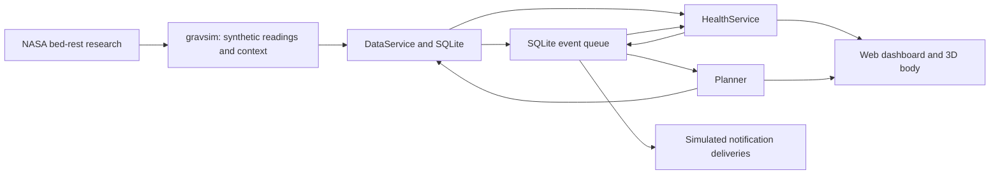

<p align="center">
  
</p>

# GraviTal

**A research-informed astronaut health monitoring prototype for long-duration missions.**

GraviTal brings simulated health measurements, personal trends, an interactive 3D body and a mission plan together in a dashboard for crew members. It was developed for the [NASA Space Apps Challenge: Create Health Monitoring Software for Astronauts on Space Missions](https://www.spaceappschallenge.org/2026/challenges/health-monitoring-software/).

> **Prototype limits:** All crew profiles and readings in the demo are synthetic. Some simulation parameters are fitted to NASA bed-rest studies on Earth, an analog for aspects of reduced loading, not actual spaceflight. GraviTal is not a medical device, a diagnosis or a clinically validated decision system.

## The problem and our approach

On a long mission, communication delays and limited access to specialists can make it harder for crew members to understand changes in their health and decide when to seek help. A single measurement may be noisy or hard to interpret without a personal baseline, a trend and information about how it was obtained.

GraviTal explores a local workflow for making that context visible. It compares simulated observations with a person's own history and with research-based reference curves, highlights findings that may need attention, and puts routine studies and follow-up tasks in a mission plan. The intent is to support crew awareness and communication with medical professionals, not replace their judgment.

## What the prototype does

- **Health summary and 3D body:** select a crew member, explore anatomical regions and layers, and see available muscle measurements. Surface boundaries are approximate. Some surface colors are illustrative, not measurements or diagnoses.
- **Vital signs:** explore simulated watch readings, sleep and heart-rate trends against a recent personal reference. Watch thresholds are prototype assumptions.
- **Muscle strength and aerobic capacity:** compare periodic simulated tests with preflight baselines and bed-rest reference data, including measurement uncertainty and alerts.
- **Eyes and neck veins:** explore simulated imaging studies and findings. The demo can introduce example eye and jugular cases; it does not acquire or process real images.
- **Mission plan:** review selected routine studies, retests and medical reviews based on the prototype's interpretation of NASA's medical standard. Tasks can be marked done; exercise-session scheduling is not implemented.
- **Notifications:** the demo records simulated deliveries. No physical wearable, ship display, radio or Earth communication link is connected.

The demo includes five prepared crew cases. See the [demo guide](docs/guia-demo.md) for a walkthrough and [surface regions](docs/surface-regions.md) for the anatomical model's limits.

## Measurements and evidence

The simulator generates new fictional readings; it does not replay astronaut telemetry. Its strength, body-composition and aerobic parameters draw on public NASA Life Sciences Portal bed-rest datasets:

| Dataset | Measurement and role |
| --- | --- |
| [MR079G: Isokinetic Muscle Function](https://doi.org/10.83263/bk5h-r757) | Dynamometer tests inform strength simulation and reference comparisons. CFT70 also supplies the frontend strength reference. |
| [MR035G: Bone Densitometry Assessment](https://doi.org/10.83263/7myc-5j86) | DXA observations inform simulated bone density and regional lean mass. |
| [MR080G: Aerobic Capacity](https://doi.org/10.83263/w056-8t76) | Cycle-test observations inform aerobic simulation and the frontend reference. |

The studies have limited sample sizes and durations; trajectories beyond observed periods are extrapolations. The [dataset inventory](data/nlsp/README.md), [fit inputs](sim/fit/source_data/README.md) and [project documentation](docs/project-documentation.md) describe provenance and limitations. MR001G is included as research context, not as an established input to the simulator fit.

The interface also presents flight equipment as context: MARES for muscle research, ultrasound, CEVIS, gas analysis and wearable monitors. These are references to documented equipment, **not connected devices**. The simulator's strength and body-composition parameters still come from terrestrial dynamometer and DXA data. See [how we measure](docs/como-medimos.md) for the sources and distinctions.

The Planner uses selected procedures from **OCHMO-STD-100.1A**; the aerobic alert implementation refers to **NASA-STD-3001 Vol. 1** and **OCHMO-TB-031**. Its schedules and rules are prototype interpretations, not an official medical plan. See [Planner design](docs/planner.md) and [HealthService alert rules](health/README.md#alert-rules).

## Architecture



1. **Simulator and DataService** (`sim/`, port 8000) generate a fictional mission, normalize and store readings and context, expose an API and publish events.
2. **HealthService** (`health/`, port 3000) compares readings with personal and research-based references, producing dashboard data, findings, alerts and notices. A worker consumes events and records simulated deliveries.
3. **Planner** (`planner/`, port 3001) uses findings, scheduled studies and crew context to arrange tests and reviews. It saves plans through the DataService and serves them to the frontend; it does not independently interpret raw readings.
4. **Frontend** (`src/front/sketch/`, port 5190 in the demo) is a React/Vite interface for the dashboard, anatomical view, trends and plan. Its development server proxies API requests to the services.
5. **SQLite** stores mission data and provides the event queue. In the demo, booked retests can generate new simulated readings, closing the loop.

See the [architecture overview](docs/architecture.md), [frontend–backend contract](docs/frontend-backend.md), [DataService](sim/README.md), [HealthService](health/README.md) and [Planner](docs/planner.md). Some older sections of the service documentation describe earlier designs; their local-demo updates and the current implementation take precedence.

## Run the demo

Requirements: **Python 3.10+**, **Node.js 20.19+ or 22.12+**, npm, Bash and curl. From the repository root on Linux or macOS:

```bash
python3 -m venv .venv
.venv/bin/pip install -e ./sim -e './health[dev]' -e './planner[dev]'
npm install
npm install --prefix src/front/sketch
bash scripts/demo.sh
```

On Windows with Git Bash, use `.venv/Scripts/pip` for the installation; see the [demo guide](docs/guia-demo.md) for platform notes and troubleshooting.

The script starts the services, prepares five fictional crew cases and waits until they are ready; startup can take more than a minute. Open [the health overview](http://127.0.0.1:5190/vuelo.html?crew=CM-3#summary) or [crew selection](http://127.0.0.1:5190/crew.html). Stop all services with **Ctrl+C**.

**Each demo start deletes and recreates `data.sqlite` and `queue.sqlite` in `.demo/`** (or the directory specified by `DEMO_DIR`). Logs are stored in the same directory. Use a separate `DEMO_DIR` if you need to preserve an existing mission. Defaults are mission day 130 and a paused clock; `DAY`, `SPEED`, `PORT`, `DATA_PORT`, `HEALTH_PORT` and `PLANNER_PORT` can be set as environment variables. Optional `SANS` and `THROMBUS` cases are described in the [demo guide](docs/guia-demo.md).

### Other ways to run

`bash scripts/start.sh` installs missing dependencies and starts the services with a progressing mission, using `/tmp/nasa-data.sqlite` and `/tmp/nasa-queue.sqlite`. Those databases persist across restarts; use new paths when starting a different mission. The script stops its processes on Ctrl+C.

To run the services individually, first install dependencies as above, then use separate terminals from the repository root:

```bash
.venv/bin/python -m gravsim.serve --day 95 --speed 20 --db /tmp/nasa-data.sqlite --queue /tmp/nasa-queue.sqlite
.venv/bin/python -m healthservice --queue /tmp/nasa-queue.sqlite
.venv/bin/python -m healthservice.demo --queue /tmp/nasa-queue.sqlite
.venv/bin/python -m planner --queue /tmp/nasa-queue.sqlite --simulate-crew
npm run dev --prefix src/front/sketch
```

Open the address printed by Vite. The worker simulates event processing and deliveries; `--simulate-crew` completes crew tasks during their windows. For frontend-only example data, run `VITE_DASHBOARD_MODE=example npm run dev --prefix src/front/sketch`. For a remote HealthService, set `VITE_DASHBOARD_URL` to its dashboard URL; the remote server must allow the frontend origin. Vite's API proxy applies only in development, so a deployed build needs accessible API URLs or a server-side proxy.

The standalone editable anatomy atlas is also available from the repository root with `npm run dev`. Its manually assigned intensities are illustrative and exist only while the page is open.

## Tests and build

After installing the dependencies above:

```bash
npm test
npm run build
npm run build --prefix src/front/sketch
.venv/bin/python -m pytest sim/tests
.venv/bin/python -m pytest health/tests
.venv/bin/python -m pytest planner/tests
```

The simulator's slower stress tests are excluded by default; see [sim/README.md](sim/README.md). If surface-region maps are regenerated with `npm run generate:surfaces`, run the tests and visually inspect the whole body; the maps depend on the pinned `open-anatomy-3d` model.

<a id="créditos-y-licencias"></a>
## Credits and licenses

- NASA Life Sciences Portal datasets and their DOIs are linked above; the [dataset inventory](data/nlsp/README.md) records the local sources.
- Anatomy models and catalog are adapted by [Open Anatomy 3D](https://github.com/MervinR07/open-anatomy-3d): BodyParts3D © Database Center for Life Science (CC BY 4.0), HuBMAP Human Reference Atlas 3D Reference Organs (CC BY 4.0), and MakeHuman (CC0). Open Anatomy code is MIT; its models and catalog are [CC BY 4.0](https://creativecommons.org/licenses/by/4.0/). See its installed `ATTRIBUTION.md` for original sources and modifications. GraviTal's derived surface maps are CC BY 4.0; the original GLB files are not modified.
- [MuscleMap](https://github.com/Jsplice/MuscleMap) (MIT) inspired the intensity visualization; its code and assets were not incorporated.
- The project was developed with AI assistance, including the GraviTal logo. Further research and asset references are in the [project documentation](docs/project-documentation.md) and [how we measure](docs/como-medimos.md).
