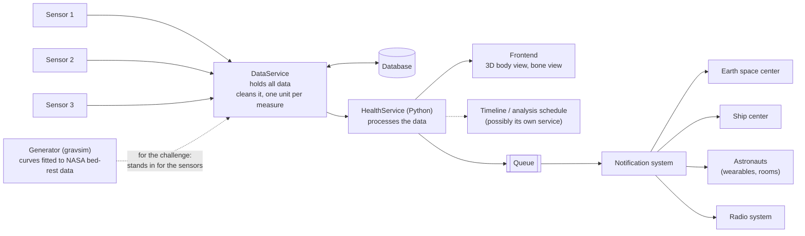

# System architecture

How the pieces of our astronaut health monitor fit together. This page follows Juan's sketch of 14 November 2026 ([original drawing](img/architecture-sketch.png)).

## The parts

| Part | What it does | State |
|---|---|---|
| **Sensors** | Instruments on board that measure the crew: dynamometer, DXA scanner, cycle ergometer with gas analyser, wearables. | We have none. The generator stands in for them. |
| **Generator** (`gravsim`) | Produces readings for a crew member on any mission day. It follows curves fitted from the NASA bed-rest data in `data/nlsp/` (the distribution in the sketch). You can set each person's exercise routine, make them lose faster than most, add an injury, or break an instrument. | Built: `sim/` on branch `feat/sensor-simulator`. |
| **DataService** | Holds all the data. Every reading, from a real sensor or from the generator, goes through the same steps: clean it (missing values, duplicates, impossible values, timestamps) and convert it to one unit per measure (for example, beats per second become beats per minute). Answers requests for a crew member's timeline. | Built: `sim/` on `feat/sensor-simulator`, being polished now. |
| **Database** | Stores real sensor data and imported historical data. | Exists but does nothing yet: the schema is defined, and for the challenge every reading comes from the generator. |
| **HealthService** (Python) | Reads from the DataService and processes the data for the other parts. Today it builds the JSON the 3D page shows: changes per muscle group and charts over time. The model work lives here: data cleaning and processing, training, inputs and outputs. | First version built (the dashboard builder in `sim/`); the model is not started. |
| **Frontend** | 3D body that colours each muscle group by how much it has changed, with a bone view. Reads the HealthService's JSON (contract in `docs/frontend-backend.md` on branch `design-body`). | In progress on `design-body`. |
| **Timeline / analysis schedule** | Decides when each test or analysis is due. Today the generator follows NASA's routine (strength every 30 days, VO2peak on flight days 14, 75, 165, bone scans only before and after flight). May become its own service. | Idea; the NASA routine exists inside the generator. |
| **Queue and notification system** | Sends alerts from the HealthService to whoever needs them: the Earth space center, the ship's center, the astronauts (through wearables and room displays) and the radio system. | Planned, not built. |

## What we can measure

| Measure | Covered by our data |
|---|---|
| Bone density | Yes (DXA, MR035G) |
| Muscle strength | Yes (dynamometer, MR079G) |
| Aerobic capacity | Yes (cycle test, MR080G) |
| Muscle mass | Partly: lean mass by body region from the same DXA scans |
| Eye exam | No |
| Venous ultrasound | No |

## Things to keep in mind

- All data in the demo is synthetic. It comes from bed-rest studies on Earth (NASA's ground analog for weightlessness), not from spaceflight, and the app has to say so.
- The bed-rest studies lasted 21 to 90 days. Anything longer is the fitted curve continued, and readings past that point are flagged as extrapolated.
