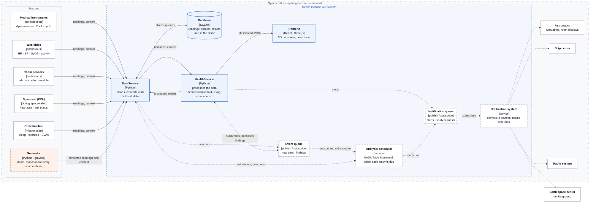

# System architecture

How the pieces of our astronaut health monitor fit together. This page follows Juan's sketch of 14 November 2026 ([original drawing](img/architecture-sketch.png)).

Legend: blue boxes are our system and built; dashed grey boxes are planned (mocked for the demo); the dashed orange box exists only for the demo; white boxes are outside our system. Solid arrows carry data today; dashed arrows are planned or demo only.

## The parts

| Part | What it does | State |
|---|---|---|
| **Sources** | Everything on board that produces data. Medical instruments run periodic tests (dynamometer, DXA scanner, cycle ergometer with gas analyser). Wearables measure continuously (heart rate, blood pressure, SpO2, activity). Room sensors say who is in which module. The spacesuit sends heart rate and suit status during spacewalks. The crew timeline says who is planned to sleep, exercise or go outside. The last three are crew context: where someone is and what they are doing. | We have none. The generator stands in for them. |
| **Generator** (`gravsim`) | Produces readings for a crew member on any mission day. It follows curves fitted from the NASA bed-rest data in `data/nlsp/` (the distribution in the sketch). You can set each person's exercise routine, make them lose faster than most, add an injury, or break an instrument. It stands in for every source, including crew context. | Built, crew context included: `sim/` on branch `feat/sensor-simulator`. |
| **DataService** | Holds all the data: readings, crew context and processed results. Every reading, from a real sensor or from the generator, goes through the same steps: clean it (missing values, duplicates, impossible values, timestamps) and convert it to one unit per measure (for example, beats per second become beats per minute). Answers requests for a crew member's timeline, current context and past results, and announces new data on the event queue. | Built: `sim/` on `feat/sensor-simulator`. |
| **Database** | Stores real sensor data, imported historical data, crew context and processed results. | Exists but does nothing yet: the schema is defined, and for the challenge every reading comes from the generator. |
| **HealthService** (Python) | Reads from the DataService and processes the data. Builds the JSON the 3D page shows, and saves every result back through the DataService. Decides who needs to know about an alert, using crew context: if an astronaut is on a spacewalk or in the bathroom, another crew member is told. The model is trained on Earth with historical data and runs on board. | First version built (the dashboard builder in `sim/`); the model is not started. |
| **Frontend** | 3D body that colours each muscle group by how much it has changed, with a bone view. Reads the HealthService's JSON (contract in `docs/frontend-backend.md` on branch `design-body`). | In progress on `design-body`. |
| **Analysis scheduler** | Its own service. Holds what NASA requires of each astronaut and when: which studies, at which points of the mission, from OCHMO-STD-100.1A Table 8 (NASA's astronaut medical standards). It reads past studies from the DataService to decide when a new study is due and records the studies it schedules. It listens on the event queue, so a finding can trigger an extra study (Table 8's "as clinically indicated"), and publishes "study due" on the notification queue. | Planned. Today a simplified NASA routine lives inside the generator. |
| **Event queue** | Publish/subscribe for things that happened: the DataService announces new data, the HealthService announces findings. The HealthService recomputes on new data; the scheduler reacts to findings. | Planned. |
| **Notification queue and system** | Publish/subscribe for messages to people. The HealthService publishes alerts, already routed by crew context; the scheduler publishes study requests. The notification system subscribes and delivers them to the astronauts (wearables, room displays), the ship's center, the radio system and the Earth space center. | Planned. |

## What we can measure

| Measure | Covered by our data |
|---|---|
| Bone density | Yes (DXA, MR035G) |
| Muscle strength | Yes (dynamometer, MR079G) |
| Aerobic capacity | Yes (cycle test, MR080G) |
| Muscle mass | Partly: lean mass by body region from the same DXA scans |
| Eye exam | No |
| Venous ultrasound | No |

## Things to keep in mind

- All data in the demo is synthetic. It comes from bed-rest studies on Earth (NASA's ground analog for weightlessness), not from spaceflight, and the app has to say so.
- The bed-rest studies lasted 21 to 90 days. Anything longer is the fitted curve continued, and readings past that point are flagged as extrapolated.
