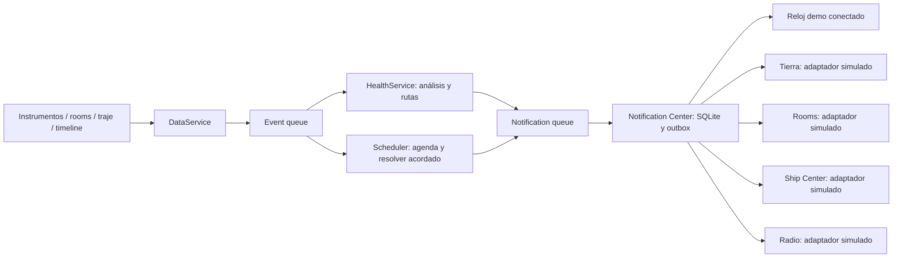

# Notification Center · alcance acordado e implementación

Base de trabajo: `main@ff450d0`, rama `feat/notification-center`, worktree independiente. Decisión de Nacho: implementar el servicio ahora y conectar al resto al final. El contrato ejecutable y las instrucciones están en [services/notification_center/README.md](../services/notification_center/README.md).

## Decisiones

1. Todas las entradas del centro llegan por Notification queue. Event queue es el canal de datos/hallazgos para los productores, no para presentar notificaciones directamente.
2. HealthService decide prioridad, destinatarios y contenido según contexto. El centro valida el plan de entrega, persiste, despacha y reintenta. El scheduler administra calendario y publica los avisos de protocolo; sus rutas deben acordarse con el resolver del productor.
3. Tierra y los destinos a bordo se programan en el mismo ciclo con ejecutores independientes. La falta de enlace terrestre nunca debe bloquear avisos locales. La recepción física depende de cada canal.
4. Aviso leve: reloj del afectado y Tierra, sin ACK obligatorio. Asistencia: añadir compañeros indicados por el productor. Urgencia: compañeros respondedores, rooms, Ship Center y Tierra desde el primer intento, además del afectado cuando corresponda. EVA: añadir radio dirigida y equipo operacional indicado.
5. El ACK confirma recepción explícita; no equivale a realizar una actividad, resolver una situación o recibir confirmación de Tierra. No se espera el ACK del afectado para notificar ayuda.
6. Se conecta el reloj de la demo existente. Tierra, rooms, Ship Center y radio tienen salidas simuladas registradas; el frontend central y las pantallas de rooms no forman parte de esta feature.
7. Rooms como entrada de ocupación y rooms como salida de presentación son funciones diferentes. El contexto se resuelve upstream. No se infiere sueño, baño o disponibilidad solo por una posición sin evidencia.
8. La prioridad proviene del productor, nunca del score visual del modelo corporal. Todos los escenarios actuales son sintéticos y no constituyen evaluaciones clínicas.

## Implementado en esta rama

- Ingreso HTTP local a una cola durable SQLite; consumidor y outbox por destino.
- Validación de contrato, idempotencia por ID/revisión, cancelaciones y revisión de rutas.
- Ejecución independiente por canal, reintentos exponenciales, recuperación al reiniciar e historial por entrega.
- Bandeja por reloj, confirmación explícita cuando se solicita, selección de astronauta y cinco fixtures publicados a la cola.
- Simulación de enlaces; desconectar Tierra permite comprobar continuidad a bordo.
- Recordatorio de protocolo de ejemplo con fecha UTC de mañana generado por productor simulado.
- Pruebas de servicio/API y proxy de desarrollo Vite. El reloj consulta la proyección del consumidor cada 800 ms; no usa SSE ni lee eventos crudos.

El detalle del payload, estados, endpoints, ejecución y limitaciones vive en el README del servicio, para evitar dos contratos contradictorios.

## Integración pendiente por responsable

| Responsable | Qué debe aportar |
| --- | --- |
| HealthService | Mensajes enrutados con ID/revisión, prioridad, contexto, destinatarios y contenido por salida; revisiones ante cambios de contexto. |
| Analysis Scheduler | Recordatorios y cambios de agenda publicados a la cola; rutas contextuales obtenidas del resolver acordado. |
| DataService / contexto | Actividad, ocupación de rooms, roster y roles disponibles para HealthService/resolver. |
| Cola / infraestructura | Broker y bridge que confirme después de persistir, credenciales, despliegue y reproceso de inválidos. |
| Tierra / rooms / radio / Ship Center | Contratos de transporte y confirmación que sustituyan al adaptador simulado. Las pantallas centrales pertenecen a su frontend. |

Referencias inspeccionadas durante el plan: `origin/data-service@0705c30` y `origin/feat/health-service@6d9f354`; siguen como integraciones independientes de esta implementación. Sus alertas y publicaciones actuales no deben tratarse como si ya cumplieran este contrato.

No se implementaron escalamiento automático por ausencia de ACK, caducidad/retención, scheduler de calendario, autenticación de actores ni broker externo. La urgencia ya convoca al equipo en su primer despacho; el escalamiento posterior requiere una política acordada. Esta entrega demuestra el circuito de notificación por separado, con datos y canales simulados.

## Verificación de la entrega

- 11 pruebas de Python del servicio y API: aprobadas.
- Build de `src/front/sketch`: aprobado; Vite advierte sobre tamaño de chunks del dashboard anatómico.
- Navegador Chromium contra Vite y API locales: probado publicación → cola → reloj, separación de astronautas, leve sin ACK, urgencia colectiva y confirmación, radio EVA simulada, Tierra desconectada y recuperación, desconexión/reconexión de API. Sin errores JavaScript de runtime en esa prueba.
- Vista de escritorio y móvil comprobada; sin desbordamiento horizontal y horas UTC en formato de 24 horas.
- No se verificaron transportes externos ni servicios de otras ramas; todavía no están conectados. No se hicieron commits ni pushes.

## Actualización tras PR #12

La PR de avisos se revisó, se resolvieron conflictos documentales con main y se mergeó. El estado vigente y el contrato operativo están en el README del servicio: ahora hay bridge de cola compartida (health.notice y study.due), proveedor Horizons y temporizadores persistentes de recepción/confirmación con endpoints por canal. Se respetan room/onboard y ship_center/operations del productor. El roster se amplía con los avisos entrantes. Las referencias anteriores a broker/latencia pendientes describen el plan previo; el broker disponible e integrado es SQLite local, no un broker de red. Las salidas físicas siguen simuladas.

Verificación final ampliada: 18 pruebas de Notification Center aprobadas; HealthService 62 aprobadas tras reconciliar main; sim 116 aprobadas y 1 xfail esperado (lentas excluidas). Fixture EVA real del productor por cola compartida y DataService HTTP confirmó todos los destinos, sin rechazos; Horizons dio 3,598 s de confirmación para Marte en la época de misión 2027-10-28T12:00:00Z. Navegador: reloj CM-4 recibió el aviso y permitió ACK sin errores JS. Build aprobado con advertencia de tamaño de chunks. PR #12 mergeada en 5b83e79; issue #11 cerrada y verificación registrada.

Preparación de publicación: rama actualizada a main@4f2d6ec; compatibilidad con Planner incorporado. Notification Center cambia a puerto 3002, conserva proxies de Planner 3001 y admite plan.reminder / plan.missed, además de health.notice y study.due.
