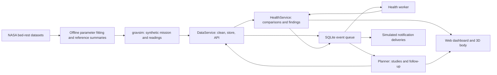

# GraviTal — Project documentation and submission workspace

**NASA Space Apps Challenge 2026 · Working document · Updated 15 November 2026**

> GraviTal is a research-informed prototype. Its demonstration uses synthetic crew data, not astronaut measurements. It is not a medical device, a diagnosis, or a validated clinical decision system. Text marked **[TO COMPLETE]** needs the team's input; **[VERIFY]** marks an unresolved claim or submission requirement.

## 1. Project at a glance

**Challenge:** [Create Health Monitoring Software for Astronauts on Space Missions](https://www.spaceappschallenge.org/2026/challenges/health-monitoring-software/). The official brief asks for a visual tool that helps astronauts assess their health and offers guidance on possible actions. It identifies the astronaut as the main user and considers long missions, limited access to support, and a variety of possible health indicators.

**The problem.** A crew member needs to understand changes in health over time, but isolated measurements can be hard to interpret. On distant missions, communication delays and limited access to specialists make understandable information and an organized next step especially valuable.

**Our approach.** GraviTal brings simulated wearable observations, periodic strength and aerobic tests, a personal baseline, an interactive body, and a mission plan into one interface. It compares measurements with the person's own history and bed-rest reference data, surfaces changes and measurement uncertainty, and proposes follow-up tasks. Its purpose is to support a conversation and situational awareness, not replace a flight surgeon.

**Who uses it.** The primary user is a crew member reviewing their own status and tasks. A crew medical officer or flight surgeon is a potential recipient of findings; actual transmission to people or devices is not implemented.

**Why this design.** Daily wearable trends can provide an early signal between less frequent tests; periodic tests add a different view of physical capacity. A personal baseline provides context for change, while explicit uncertainty helps avoid interpreting a single noisy test as a definitive result. The body view helps locate measured muscle groups, and the plan turns prototype findings into visible follow-up tasks.

## 2. What the prototype does

| Experience | Current behavior | Boundary |
|---|---|---|
| Health summary and body | Shows a crew member's summary and an interactive 3D anatomical model with selectable regions and layers. | Surface regions are approximate; color is a visual mapping, not a diagnosis or a complete measure of muscle health. |
| Vital signs | Shows simulated watch-derived daily signs against a personal history, plus heart-rate context and trends. | The watch and all readings are simulated; thresholds are prototype assumptions. |
| Muscle strength | Shows periodic dynamometer results, change from preflight, noise bands, levels, alerts and upcoming tests. | Not every muscle is measured; one test's level is not itself a confirmed alert. |
| Aerobic capacity | Shows simulated VO₂peak tests and context, including the prototype's interpretation of a NASA minimum and loss threshold. | Missing test details are displayed as not recorded; rule behavior and thresholds need expert review. |
| Mission plan | Displays routine studies, follow-up tests and reviews; tasks can be marked done. | Planning is a prototype based on selected procedures, not a complete mission medical plan. Exercise-session scheduling is not implemented. |
| Notifications | The worker publishes findings and notices and records simulated deliveries. | No actual watch, room display, radio or Earth communication is connected. |

The initial standalone atlas also supports manually editable intensity values; those values are illustrative. The integrated flight demo uses HealthService data. See [demo guide](guia-demo.md), [frontend contract](frontend-backend.md) and [surface-region limits](surface-regions.md).

## 3. Architecture and data flow


The diagram is a design overview; dashed components are stand-ins and planned components should not be read as shipped features. The operational path is:



1. **Preparation:** scripts derive simulation parameters and CFT70 reference summaries from open bed-rest datasets. The simulator generates a fictional mission, measurements and context; it does not replay real astronauts' telemetry.
2. **DataService (`sim/`, port 8000):** normalizes units and timestamps, retains quality flags, stores readings, context and results in SQLite, exposes HTTP endpoints and publishes events. It does not interpret clinical meaning.
3. **HealthService (`health/`, port 3000):** reads good-quality measurements, calculates changes from preflight reference and compares them with fitted bed-rest curves. It produces dashboard data, findings, alerts and notices. A worker processes queued events for the demo.
4. **Planner (`planner/`, port 3001):** uses findings, routine schedules and crew context to book tests and reviews. It consumes conclusions rather than independently interpreting raw measurements; the plan is saved through the DataService.
5. **Frontend (`src/front/sketch/`):** a React/Vite interface reads the dashboard, analyses, vitals and plan, and displays the 3D model and charts. In development Vite proxies API requests to the local services. The page polls and retains the last valid data with an error notice when a request fails.
6. **Events and delivery:** SQLite-backed queues connect the services. The demo worker records deliveries for inspection; it does not contact real recipients. With `--run-booked`, the simulator can generate booked retest readings, closing a simulated loop.

The software runs locally in the demo. This does not establish flight readiness, secure deployment, or end-to-end operation in a spacecraft. See [architecture](architecture.md), [DataService](../sim/README.md), [HealthService](../health/README.md), [Planner](planner.md), and [notifications](health-notices.md). Some older sections of service READMEs describe earlier designs; their local-demo updates and the current code take precedence.

### Interpretation rules and uncertainty

- Strength and aerobic results are compared with a preflight reference; individual test levels describe the size of the change. The interface shows a measurement-noise band.
- A suspected finding may follow one test beyond noise; a confirmed finding and alert use additional evidence, including an average of two tests for the documented periodic-test rules. The faster-than-typical rule compares the change against a no-exercise bed-rest reference and its estimated measurement noise.
- The VO₂peak rule uses the prototype's implementation of a 32.9 ml/kg/min minimum and 20% loss threshold, with an average of two tests. The [evaluation](../health/README.md#alert-rules) documents false alerts in simulated cases and an open question about applying the minimum after landing. These are not validated treatment criteria.
- Watch trends use an individual recent reference and a three-day pattern; SpO₂ below a prototype threshold can be flagged immediately. The numerical watch rules are team assumptions, not NASA standards. Details: [wearable design](wearable.md) and [HealthService](../health/README.md#the-watch-vitalspy).
- Findings can schedule follow-up or review, but the prototype does not establish what a real crew should do medically. The simulator's internal truth can evaluate rules in simulation only; it cannot validate performance on real people.

## 4. Data, evidence and attribution

### NASA datasets and how they enter the project

All four experiments below are documented in the [NASA Life Sciences Portal](https://nlsp.nasa.gov/) and the local [dataset inventory](../data/nlsp/README.md). Bed rest is a ground analog of some effects of unloading, not spaceflight. Files are pseudonymized research observations, whereas the displayed mission data are synthetic.

| Dataset | Measures and role in GraviTal | Source |
|---|---|---|
| MR079G, Isokinetic Muscle Function | Strength measurements inform simulated baselines, variation, noise and fitted changes. CFT70 supplies the strength reference summary shown by the frontend; additional studies of different durations support the simulator fit. | [DOI 10.83263/bk5h-r757](https://doi.org/10.83263/bk5h-r757); [fit inputs](../sim/fit/source_data/README.md) |
| MR035G, Bone Densitometry Assessment | DXA bone density and regional lean-mass observations inform the simulator's bone and body-composition parameters. | [DOI 10.83263/7myc-5j86](https://doi.org/10.83263/7myc-5j86) |
| MR080G, Aerobic Capacity | Cycle-test observations inform aerobic simulation parameters; CFT70 also supplies the frontend aerobic reference summary. | [DOI 10.83263/w056-8t76](https://doi.org/10.83263/w056-8t76) |
| MR001G, Neuroendocrine and Cardiovascular Response to Tilt | Available locally as research context on orthostatic and cardiovascular responses. The fitting script identifies MR079G, MR035G and MR080G as its data sources; do not claim MR001G drives the simulator without further verification. | [DOI 10.83263/gz1q-a824](https://doi.org/10.83263/gz1q-a824) |

The [fitting script](../sim/fit/fit_params.py) reads MR079G CFT70 from `data/nlsp/` and additional strength studies from `sim/fit/source_data/`; it writes the simulator parameters in [`params.json`](../sim/gravsim/params.json). Separate [strength](../scripts/build-cft70-reference.py) and [aerobic](../scripts/build-cft70-aerobic-reference.py) scripts build summaries for the frontend. The demo generates new synthetic readings from fitted parameters and assumptions, and the HealthService compares them with reference curves; the reference summaries are not individual astronaut histories.

CFT70 includes control and exercise groups and pre/post measurements, but the local inventory notes no measurements during bed rest and a strongly male-skewed sample. Group sizes are small, protocols differ, and simulated trajectories beyond observed study durations are extrapolations. These limitations prevent generalizing the output to a specific astronaut or mission. Verify the description of the CFT70 `FLY` group before labeling it.

### Standards, research and other resources

- **OCHMO-STD-100.1A:** the [local text](references/OCHMO-STD-100.1A_RevA_2024-09-09.txt) and [PDF](references/OCHMO-STD-100.1A_RevA_2024-09-09.pdf) inform the Planner's selected routine studies, windows and explanatory citations. The implemented schedule is a prototype interpretation, not an official NASA plan. See [Planner design](planner.md).
- **NASA-STD-3001 Vol. 1 and OCHMO-TB-031:** cited in the [alert-rule documentation](../health/README.md#nasa-standard-vo2peak) as sources for the aerobic minimum and performance-loss criterion. The prototype's calculation and scope still require expert review.
- **NASA Human Research Program:** [spaceflight hazards](https://www.nasa.gov/hrp/hazards/) and [risks](https://www.nasa.gov/hrp/risks/) provide the broader mission and health context, not measurements or validation of this app.
- **Canadian Space Agency:** [why research is conducted in space](https://www.asc-csa.gc.ca/eng/iss/science/why-do-we-conduct-science-experiments-in-space.asp) and [radiation monitoring](https://www.asc-csa.gc.ca/eng/news/articles/2026/2026-02-26-monitoring-radiation-astronaut-health.asp) provide context from challenge resources; radiation monitoring is not implemented in GraviTal.
- **Tele-SUS:** [published research](https://pmc.ncbi.nlm.nih.gov/articles/PMC8047175/) informs the team's exploration of muscle monitoring; ultrasound acquisition is not implemented.
- **3D anatomy:** [Open Anatomy 3D](https://github.com/MervinR07/open-anatomy-3d) supplies the anatomical model and catalog. Its credited sources include BodyParts3D (CC BY 4.0), HuBMAP Human Reference Atlas organs (CC BY 4.0) and MakeHuman (CC0). The project adds derived surface-region maps under CC BY 4.0. Consult the [root README](../README.md#créditos-y-licencias) and the package attribution for full credits. [MuscleMap](https://github.com/Jsplice/MuscleMap) inspired the visual approach; its code and assets were not incorporated.
- **[TO COMPLETE]** Audit and list all remaining third-party libraries, assets, publications, licenses, and any team-created or AI-assisted material before submission.

## 5. Running and presenting the demo

Requirements: Python 3.10+ and Node.js 20.19+ or 22.12+. From the repository root:

```bash
python3 -m venv .venv
.venv/bin/pip install -e ./sim -e './health[dev]' -e './planner[dev]'
npm install
cd src/front/sketch && npm install && cd ../../..
bash scripts/demo.sh
```

For Windows shell paths, configuration options and troubleshooting, see the [demo guide](guia-demo.md). The script starts the services and frontend, creates fresh simulated mission data in `.demo/`, and opens the demo at `http://127.0.0.1:5190/vuelo.html`. Stop with Ctrl+C. The root [README](../README.md) explains individual services and the example-data mode.

Suggested walkthrough:

1. Select **CM-3** in Health summary. Show the watch panel and the simulated resting-heart-rate deviation; explain that it is compared with the person's recent history and results in a review task.
2. Open **Vital signs** to show trends and personal reference bands. Explain the 3-day pattern and that thresholds are experimental.
3. Switch to **CM-2** to show the simulated aerobic alert and the body view. Explain what each test actually measures and the limitations of colors and comparisons.
4. Open **Mission plan** to show routine and follow-up tasks, instructions and citations. Explain that deliveries and the crew are simulated.
5. Show **Muscle strength** and **Aerobic capacity** to explain preflight reference, periodic tests, uncertainty and the bed-rest comparison.

The guide describes a longer live walkthrough; the official submission demo may have a different time or slide limit. **[VERIFY]** Confirm the current guide before recording.

## 6. Submission workspace

The following is a working draft, not a submitted form. The team made a direct review of the official guide on 14 November 2026. The official challenge and submission pages returned HTTP 502 during this documentation pass on 15 November; **recheck the current form and guide** for exact fields, eligibility, limits, AI disclosure and deadlines. The local research records an English-language submission, a public demo link and a public final-project link, plus fields for NASA data, other references and AI use.

### Project name

**GraviTal — Astronaut Health Monitoring** **[TO COMPLETE: confirm final title]**

### High-level project summary — draft

GraviTal is a research-informed prototype that helps astronauts explore changes in their health during long missions. It combines simulated wearable trends and periodic strength and aerobic measurements with an interactive body view and a mission plan. NASA bed-rest research informs the simulated data and comparisons, while personal baselines and measurement uncertainty provide context. GraviTal highlights possible follow-up for human review; it is not a medical diagnosis or a validated clinical tool.

### Detailed project description — draft

Long missions can make immediate medical support difficult. GraviTal brings information that would otherwise be spread across measurements and schedules into an interface designed for the crew. A synthetic mission generates watch readings, strength tests and aerobic assessments. The DataService cleans and stores these records; the HealthService compares them with the person's preflight or recent history and with research-derived references. Findings feed a Planner that displays routine studies and follow-up reviews. A React dashboard presents trends, an interactive 3D body and a mission plan.

The prototype uses NASA Life Sciences Portal bed-rest datasets to fit simulation parameters and build comparison summaries, and selected NASA medical standards to inform the planner and experimental aerobic rule. Bed rest is an Earth-based analog, not a record of astronauts in flight. All displayed crew readings are synthetic; notifications are simulated, and clinical performance has not been validated. Python services, SQLite, React, Vite and Three.js support the demonstration.

### NASA data — draft

We used NASA Life Sciences Portal experiments MR079G (isokinetic muscle function), MR035G (bone densitometry), and MR080G (aerobic capacity) to fit parameters for synthetic mission data and build selected bed-rest comparison summaries. MR001G (cardiovascular response to tilt) is retained as background data. We also consulted OCHMO-STD-100.1A for selected routine-study scheduling and NASA human spaceflight health resources for context. Dataset DOIs and detailed uses appear in section 4.

### Other references and AI use — complete before submitting

- **[TO COMPLETE]** List every external source and asset used, with links, license and attribution; include the anatomical model and agency resources in section 4.
- **[TO COMPLETE]** Describe all AI tools used and their actual contributions. The [HealthService README](../health/README.md#ai-use) records assistance from Claude; verify the rest with the team. Check the official guide's disclosure and labeling requirements for each medium.
- **[TO COMPLETE]** Public final project/repository URL: ______
- **[TO COMPLETE]** Public demo URL and format: ______
- **[TO COMPLETE]** Team name, members, roles and local event: ______
- **[TO COMPLETE]** License for this project's own code and content: ______
- **[VERIFY]** Confirm form fields, allowed demo format and length, submission deadline and timezone, eligibility, access permissions, and any local-event requirements with the current official guide and event organizers.
- **[VERIFY]** Confirm that all team members are registered correctly, all linked material is public, and the submission and disclosures accurately reflect the finished work.

## 7. Further technical and research documentation

- [System architecture](architecture.md) · [frontend/backend contract](frontend-backend.md) · [HealthService design](health-service.md) · [Planner](planner.md) · [wearable](wearable.md)
- [Demo guide](guia-demo.md)
- [Dataset inventory](../data/nlsp/README.md) · [simulator and fit](../sim/README.md) · [strength fit sources](../sim/fit/source_data/README.md)
- [Muscle research sources](fuentes-investigaciones-musculares.md) · [gravity research](investigacion-gravedad.md) · [eyes](investigacion-ojos.md) · [neck veins](investigacion-yugular.md)
