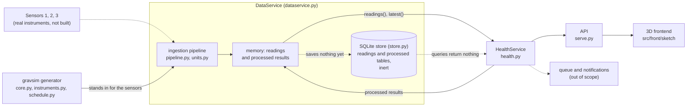

# gravsim: simulated instrument readings for the gravity hazard

We have no dynamometer, DXA scanner, metabolic cart or flight wearable. `gravsim` stands in for them: it produces readings for a crew member on any mission day, following the curves measured in NASA's open bed-rest studies (the files in `data/nlsp/`). Readings are random by default and fully controllable: exercise adherence over time, fast responders, injuries on a chosen day, broken instruments.

The readings then travel the way real sensor data would. A DataService cleans and stores them, a HealthService turns them into the dashboard JSON that the 3D page in `src/front/sketch` reads (contract version 1, `docs/frontend-backend.md` on the `design-body` branch), and `serve.py` puts that on HTTP.

All data it produces is synthetic and every reading says so (`synthetic: true`).

## Quick start

You need Python 3.10 or newer. From the repository root:

```bash
cd sim
pip install -e ".[dev]"      # numpy, plus pandas and pytest
python -m pytest -q          # 84 quick checks, about 20 seconds
python -m pytest -q -m slow  # 85 stress tests against the data ranges and NASA standards, about 2 minutes
```

The stress tests sample thousands of simulated crew members; run them after changing the generator or `params.json`.

Feed the 3D page:

```bash
python -m gravsim.serve --day 95 --speed 20 --port 3000
# then, in src/front/sketch on the design-body branch:
VITE_DASHBOARD_URL=http://localhost:3000/api/v1/dashboard npm run dev
```

Or use it from Python:

```python
import gravsim as gs

mission = gs.Mission("iss_180", launch_date="2027-03-01")
ana = mission.add_crew("CM-1", sex="F", adherence=1.0, seed=1)                        # follows the exercise routine
ben = mission.add_crew("CM-2", adherence=[(0, 1.0), (60, 0.2), (120, 1.0)], seed=2)   # skips exercise for two months
ben.add_event(day=95, measures="legs", severity_pct=12, recovery_days=20, label="ankle sprain")

data = gs.DataService()
data.ingest(mission.timeline(seed=7))      # gravsim plays the sensors, on NASA's schedule

data.readings("CM-2", "knee_extension_60", end=mission.timestamp(120))   # 6 readings, L-60 to FD105
data.latest("CM-2", "bone", at=mission.timestamp(200))                   # newest hip, spine and heel scans (R+7)
dash = gs.HealthService(data).dashboard(ben, day=120)                    # the JSON for the 3D page
data.results("CM-2", kind="measure_change")                              # what that call computed, saved
```

`examples/gravsim_demo.ipynb` shows what the generator makes, with charts against the bed-rest data (it also needs `altair`; run it from `sim/examples`).

## How the pieces fit



| Box in the sketch | File | What is in it |
|---|---|---|
| "real" data for the challenge | `core.py` | `Mission`, `CrewMember` and the physiology curves |
| | `instruments.py` | the four simulated instruments and their faults |
| | `schedule.py` | `timeline()`: who is measured on which days |
| shared by every box | `reading.py` | `Reading` (raw data) and `Result` (processed data), the records that travel through the system; `to_dataframe()` |
| DataService | `dataservice.py` | `DataService`: `ingest()`, `readings()`, `latest()`, `save_result()`, `results()` |
| | `pipeline.py` | `clean()`: the ingestion rules, and `LIMITS` |
| | `units.py` | the unit registry and `convert()` |
| | `store.py` | the SQLite schema (readings and processed results) and `SqliteStore`, inert |
| HealthService | `health.py` | `HealthService.dashboard()` and `validate_dashboard()` |
| between HealthService and frontend | `serve.py` | the HTTP API |

`fit/fit_params.py` sits outside the package: it refits `gravsim/params.json` from `data/nlsp/`.

## The DataService

It holds all the data: raw readings and the processed results the HealthService computes from them.

- `ingest(records)` runs records through the pipeline and keeps them. A record is a `Reading` or a plain dict with at least `crew_id`, `measure`, `timestamp`, `value` and `unit`, so any sensor can send one.
- `readings(crew_id, measures=None, start=None, end=None)` returns a crew member's readings in a time range, oldest first, whatever their quality. `measures` takes ids or group names (`"bone"`); times can be ISO text, a `datetime` or Unix seconds.
- `latest(crew_id, measures=None, at=None)` returns the newest reading of each measure that has quality `ok`.
- `save_result(crew_id, kind, timestamp, payload)` keeps a processed result: what was computed for a crew member at a mission time, as a `Result` with the JSON `payload`, the time it was computed and the model version. Computing the same kind for the same crew member, time and model version again replaces it.
- `results(crew_id, kind=None, start=None, end=None)` reads them back, oldest first, for one kind or all of them, in a range of mission times.

Every call to `HealthService.dashboard()` saves two results for the day it shows: kind `dashboard`, the JSON it returns, and kind `measure_change`, which holds the pre-flight reference, the % change and the time of the latest reading for each measure on the page.

A reading from a real sensor goes in the same way as gravsim's:

```python
[r] = data.ingest([{"crew_id": "CM-1", "measure": "resting_hr", "timestamp": "2027-06-01T09:30:00+02:00",
                    "value": 1.15, "unit": "beats/s", "instrument": "chest strap"}])
r.timestamp, r.value, r.unit, r.quality      # ('2027-06-01T07:30:00Z', 69.0, 'bpm', 'ok')
```

**Ingestion rules** (`pipeline.py`), applied to every reading, gravsim's included:

1. A record with no crew member, no known measure or no readable time is dropped, and a warning says how many.
2. Times are stored as UTC ISO text to the second, `2027-03-01T12:00:00Z`. A time with no offset is taken as UTC.
3. A missing or unreadable value becomes `None` with quality `missing`. It is kept, because a gap is information too.
4. The value is converted to its measure's canonical unit. An unknown unit, or one of the wrong kind (kg for a heart rate), keeps value and unit as sent and gets quality `bad_unit`.
5. A value outside the physiological limits in `LIMITS` gets quality `out_of_range` and is kept unrounded. The limits are wide on purpose: a resting heart rate of 1.2 is beats per second sent as bpm, not a very calm astronaut. Values inside the limits are rounded to the measure's decimals. gravsim clamps its own readings to the same table, so nothing it makes is flagged.
6. For readings with the same crew member, measure, time, instrument and side, the last one sent wins. The result is sorted by time.

The HealthService only uses readings with quality `ok`.

**Units** (`units.py`). Each measure is stored in the unit `params.json` gives it. `UNITS` maps every accepted unit to that canonical unit and a factor, and `gs.convert(100, "N·m", "ft-lb")` gives 73.76.

| Canonical unit | Also accepted |
|---|---|
| ft-lb (torque) | N·m, Nm |
| g/cm² (bone density) | g/cm2, mg/cm², mg/cm2 |
| g (lean mass) | kg, lb |
| bpm (heart rate) | beats/s |
| mmHg (blood pressure) | kPa |
| % (SpO2) | fraction (0.97 for 97 %) |
| ms (HRV) | s |
| ml/kg/min (VO2peak) | |

To accept a new unit, add one line to `UNITS`.

**The store** (`store.py`) is where real sensor data, imported historical data and the processed results would live. For the challenge it does nothing on purpose: `SqliteStore` creates its two tables (in memory by default), its save methods write nothing and its query methods return an empty list, so the demo runs on what the DataService holds in memory.

- `readings` has one row per reading, keyed by crew member, measure, time, instrument and side, with the value in its canonical unit, the quality, a `synthetic` flag and the remaining fields as JSON.
- `processed` has one row per result: crew member, kind, the mission time it is for, when it was computed, the model version and the payload as JSON. The key is crew member, kind, time and model version, so a recomputed result replaces the old one and a new model version adds a row that can be compared with the old.

Making it real means an `INSERT OR REPLACE` in `save()` and `save_results()` and a `SELECT` in `query()` and `query_results()`.

**The API** (`python -m gravsim.serve`), all `GET`:

| Path | Returns |
|---|---|
| `/api/v1/dashboard` | the dashboard JSON (contract version 1) |
| `/api/v1/readings` | every reading so far, as JSON records |
| `/api/v1/latest` | the newest usable reading of each measure |

Query parameters: `crew=CM-2` (default: the first), `day=150` (default: the mission clock), `measures=bone,vo2peak` (for `/readings` and `/latest`). At start-up the server generates the whole mission and ingests it. `--speed 20` moves the mission clock 20 days per real minute, so the page, which polls every 3 seconds, shows the mission unfolding.

## The generator

**Mission.** A list of phases with a gravity level. Presets:

| Preset | Phases | Covered by the data? |
|---|---|---|
| `iss_180` (default) | 180 days at 0 g, then a year back on Earth | Up to day 90; after that the curves are extrapolated |
| `artemis_30` | 12 days transit, 6 on the Moon (0.166 g), 12 back | Assumption: no data for partial gravity |
| `mars` | 180 days transit, 500 on Mars (0.38 g), 180 back | Assumption: no data for partial gravity or for 860 days |

Custom missions: `gs.Mission([gs.Phase("flight", 0, 120, 0.0), ...])`. Partial gravity scales the unloading by `1 - g` unless you pass `unloading=` your own function. `mission.timestamp(day)` and `mission.day_of(timestamp)` convert between mission days and UTC times.

**CrewMember.** One person, consistent across readings. Sex, age and mass (random if not given), a baseline for every measure and a personal response (sampled from the spread between subjects, at most 2 SD from the median). Baselines come from the subjects' own pre-bed-rest values for that sex, never below the smallest or above the largest of them. They are drawn together: of two people of the same sex, the one with more leg muscle is usually the stronger and the heavier (a Gaussian copula fitted on the 65 subjects with both strength and DXA data), and systolic and diastolic pressure move together. The status controls:

| Status | Parameter |
|---|---|
| Normal (following the routine) | `adherence=1.0`, the Campaign 11 exercise group's curve |
| Not normal (no exercise) | `adherence=0.0`, the control groups' curve |
| Partly following it | `adherence=0.6`, or steps over time: `[(0, 1.0), (60, 0.2), (120, 1.0)]`, or a function of the day |
| Damaged: losing faster than almost everyone | `responder="fast"` (between the 90th percentile and 2 SD), or a number of standard deviations (cut to -2..2) |
| Damaged: an event | `crew.add_event(day, measures="legs", severity_pct=12, recovery_days=20)` |
| Broken instrument | `Fault("offset", start, end, pct=-1.1)`, `"drift"`, `"dropout"`, `"spike"`, `"stuck"` on the instrument; after a dropout, later faults have nothing to act on |

Measure groups for events and queries: `legs`, `trunk`, `arms`, `bone`, `cardio`, `strength`.

**Instruments.** `measure(crew, day, measure)` returns one `Reading`, `measure_all(crew, day)` one per measure, and `session(crew, day)` the whole session as the device records it.

```python
r = gs.Dynamometer(seed=3).measure(ben, day=104, measure="knee_extension_60")
r.value, r.unit, r.day_label      # (63.1, 'ft-lb', 'FD105'): one test, noise included
r.truth                           # {'value': 53.927, 'change_pct': -27.917, 'faults': []}
```

| Instrument | Measures | `session()` |
|---|---|---|
| `Dynamometer` | knee extension/flexion 60°/s, ankle plantar/dorsiflexion 30°/s, trunk extension/flexion 60°/s (ft-lb) | every test with its repetitions |
| `DxaScanner` | hip, spine, heel bone density (g/cm²); lean mass of legs, arms, trunk (g) | full report, left and right hip |
| `CycleErgometer` | VO2peak (ml/kg/min) | graded test stage by stage: watts, heart rate, VO2, Borg, ending part-way through the last stage at the workload where the person reaches VO2peak |
| `Wearable` | resting heart rate, systolic and diastolic pressure, SpO2, HRV | 24 hours of minute-by-minute heart rate |

`noise=0` on an instrument (or on `timeline()`) turns measurement noise off; `noise=0.5` halves it. Noise has two parts: the instrument's own (assumed from typical device accuracy) and the person's day-to-day variation (the rest of what repeat tests in the data show), which every reading of that measure on that day shares. Inside the data's coverage a reading without a fault is clipped to the data range (see "What the data checks guarantee"); faults may push it out. Every reading, faulty or not, stays inside the hard limits in `LIMITS`.

**Reading fields.** `crew_id`, `mission_day`, `day_label` (L-30, FD12, R+5), `timestamp`, `phase`, `gravity_g`, `instrument`, `device`, `measure`, `label`, `value`, `unit`, `region`, `muscle_keys` (the 3D page's keys, e.g. `quadriceps_l`), `side`, `quality` (`ok`, `missing`, `out_of_range` or `bad_unit`), `synthetic`, `extrapolated`, `model_version`, `status` (adherence, responder, recent events) and `truth` (noise-free value, true % change, active faults). A real monitoring system would not see `truth`; it is there to score one. Real sensors leave the mission fields and `truth` empty. `gs.to_dataframe(readings)` makes a pandas DataFrame with one row per reading.

**Timeline.** `mission.timeline()` uses the NASA routine from `docs/investigacion-gravedad.md` and OCHMO-STD-100.1A Table 8 (rows cited in `schedule.py`): DXA only before and after flight (there is no DXA on the ISS), strength every 30 days, VO2peak on flight days 14, 75 and 165 and 14 days before return, the wearable daily, two baseline sessions before launch. `mission.timeline(schedule=7)` reads everything every 7 days instead. `until=day` gives the timeline so far. `gs.Mission.random(seed=...)` makes a crew with random statuses (some slipping on exercise, the odd fast responder or injury).

## How the curves are built

The data measured people before and after 21 to 90 days of head-down bed rest, with few readings in between. So the shape over time comes from comparing studies of different lengths, and from the follow-up scans after them.

- Strength, lean mass, VO2peak, resting heart rate and pressure approach a plateau with a time constant of 28.5 days, fitted on knee extension across HDT30 (30 days), Campaign 1 (60), Campaign 3 (60 or 90) and Campaign 11 (70). Back in gravity they recover with their own time constant.
- Bone density falls at a steady rate per unloaded day and recovers slowly afterwards (Campaign 3 follow-up scans up to two years).
- Exercise scales the loss by `1 - exercise_effect × adherence`, with the effect taken from Campaign 11's exercise and control groups and capped at 0.9. The spread between people shrinks with exercise, but to no less than half.
- Each measure has a direction: strength, lean mass, bone and VO2peak fall, resting heart rate and pressure rise. A person's loss never crosses zero into improvement while unloaded.
- The spread between people comes from the post-bed-rest changes of each cohort, after dropping failed tests (such as a -73 % knee extension in MEDES) and subtracting measurement noise.
- Measurement noise comes from repeat tests before bed rest and from same-day duplicate DXA scans. For DXA all of it is the scanner. For the other instruments an assumed device noise is taken out and the rest is the person's day-to-day variation.
- Baselines: the pre-bed-rest values of every subject in the files (137 people for strength: AG Pilot, Campaign 1, 3 and 17, CFT70, HDT30 and MEDES), kept as quantiles per sex in `params.json`.

`params.json` holds every number with its source; `python fit/fit_params.py` refits it from `data/nlsp/`, and `python fit/fit_params.py --table` prints this table from it. The current fit ("pts" are percentage points of change; noise as a share of the value):

| Measure | Instrument | Unit | Worse is | Shape without exercise | Loss prevented by full exercise | Spread between people | Recovery time constant | Noise: device + day to day | Baselines drawn from | Assumed instead of fitted |
|---|---|---|---|---|---|---|---|---|---|---|
| `knee_extension_60` | dynamometer | ft-lb | lower | plateau -23.5% | 64% | 5.7 pts | 19 d | 5.0% + 6.7% | 49.5 to 328.4 (137 people) | none |
| `knee_flexion_60` | dynamometer | ft-lb | lower | plateau -13.6% | 90% | 5.8 pts | 19 d | 5.0% + 8.9% | 31.5 to 178.2 (137 people) | exercise effect capped at 0.9 (fitted 1) |
| `ankle_plantarflexion_30` | dynamometer | ft-lb | lower | plateau -25.7% | 12% | 3.8 pts | 19 d | 5.0% + 9.2% | 42.2 to 186.3 (137 people) | none |
| `ankle_dorsiflexion_30` | dynamometer | ft-lb | lower | plateau -6.8% | 70% | 3.3 pts | 19 d | 5.0% + 8.9% | 10.5 to 49.0 (137 people) | exercise effect |
| `trunk_extension_60` | dynamometer | ft-lb | lower | plateau -17.7% | 77% | 9.3 pts | 19 d | 5.0% + 7.2% | 72.7 to 628.5 (128 people) | none |
| `trunk_flexion_60` | dynamometer | ft-lb | lower | plateau -2.8% | 70% | 8.1 pts | 19 d | 5.0% + 11.2% | 49.7 to 286.0 (128 people) | exercise effect; Campaign 11 left out (runs the wrong way) |
| `hip_bmd` | DXA | g/cm² | lower | -1.38% per month | 50% | 0.46 pts/month | 405.5 d | 0.8% + 0.0% | 0.822 to 1.270 (74 people) | exercise effect |
| `spine_bmd` | DXA | g/cm² | lower | -0.10% per month | 50% | 0.71 pts/month | 399 d | 0.6% + 0.0% | 0.880 to 1.193 (74 people) | exercise effect; spaceflight loss likely larger |
| `heel_bmd` | DXA | g/cm² | lower | -0.38% per month | 50% | 0.88 pts/month | 286.2 d | 0.8% + 0.0% | 0.474 to 0.861 (50 people) | exercise effect |
| `lean_legs` | DXA | g | lower | plateau -6.5% | 64% | 4.7 pts | 19 d | 0.9% + 0.0% | 9515 to 26748 (74 people) | loss time constant; exercise effect; recovery time constant |
| `lean_arms` | DXA | g | lower | plateau +0.0% | 64% | 0.0 pts | 19 d | 2.1% + 0.0% | 2973 to 11118 (74 people) | loss time constant; exercise effect; recovery time constant; loss set to 0 (fitted +0.2%) |
| `lean_trunk` | DXA | g | lower | plateau -1.0% | 64% | 3.2 pts | 19 d | 0.9% + 0.0% | 16460 to 36053 (74 people) | loss time constant; exercise effect; recovery time constant |
| `vo2peak` | cycle | ml/kg/min | lower | plateau -22.2% | 70% | 8.6 pts | 16.8 d | 3.0% + 4.8% | 33.0 to 53.6 (42 people) | loss time constant |
| `resting_hr` | wearable | bpm | higher | plateau +31.1% | 54% | 8.5 pts | 6.2 d | 3.0% + 4.9% | 54 to 100 (38 people) | loss time constant |
| `resting_sbp` | wearable | mmHg | higher | plateau +3.3% | 0% | 1.9 pts | 10 d | 3.3% + 4.9% | 102 to 138 (38 people) | loss time constant; recovery time constant |
| `resting_dbp` | wearable | mmHg | higher | plateau +13.4% | 1% | 3.5 pts | 10 d | 4.0% + 6.8% | 64 to 86 (38 people) | loss time constant; recovery time constant |
| `spo2` | wearable | % | lower | constant |  |  |  | 1.0% + 0.0% | 95 to 100 (assumed) | everything (no data) |
| `hrv_rmssd` | wearable | ms | lower | constant |  |  |  | 5.0% + 14.1% | 15 to 90 (assumed) | everything (no data) |

`tests/test_gravsim.py` checks the curves against the data: knee extension at 30 and 70 days with and without exercise, VO2peak at 70 days, hip loss per month, VO2 recovery, the spread between subjects, and the heart-rate rise at the same cycling workload (Campaign 3: a median 27.5 bpm).

## What the data checks guarantee

Two test files check the generator against numbers it was not fitted with. `tests/data_ranges.json` holds the smallest and largest value of every measure in the raw NASA files, worked out by a separate script. `tests/nasa_standards.json` holds NASA's thresholds, each with its document, page and quote. When `python -m pytest -m slow` passes, this holds:

- Every crew member starts with values a real bed-rest subject had. Nobody is stronger, weaker or fitter, or has denser or thinner bones, than the extremes in the data.
- A reading taken before launch with a working instrument is never outside the smallest and largest pre-bed-rest value in the data. Up to 90 days without gravity it is never outside what the subjects showed after bed rest: their starting range combined with their range of change.
- A person's true change up to 90 days without gravity stays inside the range of changes the subjects showed.
- No reading is physically impossible, even from a broken instrument: oxygen saturation at most 100 %, heart rate 30 to 220, systolic pressure 60 to 250, diastolic 30 to 150, nothing negative. The DataService checks the same limits.
- A reading outside the data's range always says why: it is flagged `extrapolated` (more than 90 days without gravity, or partial gravity), or the fault that moved it is listed in `truth["faults"]`.
- Measures move the way the body does. Without gravity, strength, lean mass, bone and aerobic capacity go down or stay, and resting heart rate and pressure go up or stay. Skipping exercise never leaves a person better off than exercising, an injury never helps, and a fast responder never gains.
- The same seeds give the same data, a person's two hips differ by at most 3 %, and leg strength goes with leg muscle.
- Crew start out meeting NASA's entry numbers: VO2peak of at least 32.9 ml/kg/min and resting pressure below 140/90.
- On the exercise routine, at least 9 in 10 crew keep VO2peak and knee and trunk strength above 80 % of their pre-flight value, as NASA requires in flight. Without exercise, the typical crew member falls below it between 3 weeks and 3 months. Hip loss, recovery within 45 days for VO2 and strength, and about a year for bone match the NASA documents.

What they do not guarantee: anything past 90 days without gravity, or in partial gravity, is the fitted curve continued. Two known gaps are kept on purpose and marked as expected failures (see "Decisions").

## Decisions (open to veto)

These are choices, not facts from the data. Each one can be undone in one place, named in brackets.

1. Crew are astronauts, so baselines come only from bed-rest subjects who meet NASA's standards: VO2peak of at least 32.9 ml/kg/min (NASA-STD-3001 Vol 1 Rev C [V1 4001]) and resting pressure below 140/90 mmHg (OCHMO-STD-100.1A Rev A, Appendix A, G.3). That keeps 42 of 68 subjects for VO2peak and all 38 for pressure. [`ASTRONAUT` in `fit/fit_params.py`]
2. Calf strength on the exercise routine breaks NASA's 80 % rule [V1 4024]: about 3 in 4 crew lose more than 20 % by flight day 180. Bed-rest exercise barely protected the calves (Campaign 11's exercise group lost 19 %, the controls 21 %), while ISS exercise targets them. gravsim follows the data and invents no protective effect. The test is an expected failure. [`test_standards.py`]
3. About 1 in 10 single pre-flight pressure readings reach 140/90, though no crew member's true pressure and no 14-day average does. The day-to-day variation comes from the only repeat pressures in the data, two clinic visits weeks apart in CFT70 (14 people). Expected failure. [`test_standards.py`]
4. Spine density barely changes in bed rest (-0.1 % a month). gravsim keeps it at zero or falling; in spaceflight the spine likely loses more than bed rest suggests.
5. Arm lean mass was fitted at +0.2 %, so its loss is set to 0 and readings vary only by scanner noise. [`finish()` in `fit/fit_params.py`]
6. Exercise removes at most 90 % of a loss (knee flexion was fitted at 100 %, which made every exercising person identical), and responses are cut at 2 SD from the median. [`MODEL` in `fit/fit_params.py`]
7. Device noise per reading is assumed: dynamometer ±5 %, gas analyser ±3 %, pressure cuff ±3 to 4 mmHg, heart rate ±2 bpm. [`DEVICE` in `fit/fit_params.py`]
8. Each strength subject is counted once: Campaign 11's strength file repeats CFT70's tests for 15 of its people, so the files hold 137 people, not 152. Sex comes from the DXA files and the CFT70 demographics, which share subject codes with the strength files; HDT30 and Campaign 17 have no sex in the files and only enter the pooled distribution.
9. Hip density is the average of both hips per scan, matching the left and right readings `DxaScanner.session()` reports around it.

## Limits

- Bed rest is the ground analog NASA uses, not spaceflight. Say so wherever these numbers appear.
- Past 90 unloaded days, and in partial gravity, readings carry `extrapolated: true`. The 180-day plateau is the fitted curve continued, not a measurement.
- The exercise effect on bone has no open data (Campaign 11's DXA files are restricted); 0.5 is a placeholder.
- Spine density barely moves in the bed-rest data; spaceflight spine loss is likely larger.
- Resting heart rate and pressure come from supine rest on the day subjects got up, which includes the effect of standing up again; in flight the change may be smaller.
- The cycle test's stage values use two textbook formulas (ACSM cycling equation for VO2, Tanaka 2001 for maximum heart rate), not the data.
- SpO2 and HRV have no data behind them; their ranges and noise are assumed.
- Women are few in the VO2peak and pressure data (1 of 38 in CFT70), so women's values there are drawn from everyone's.
- Groups were small (3 to 29 people per study) and some studies mix groups (AG Pilot, MEDES), so the spread between people is approximate.

## AI use

The code, the fitted parameters and this README were written with the help of an AI assistant (Claude), from the team's data and documents. Space Apps requires saying so in the project description.

## Data credit

NASA Life Sciences Data Archive, via the NASA Life Sciences Portal (https://nlsp.nasa.gov): MR079G Isokinetic Muscle Function (doi:10.83263/bk5h-r757), MR035G Bone Densitometry Assessment (doi:10.83263/7myc-5j86), MR080G Aerobic Capacity (doi:10.83263/w056-8t76).
