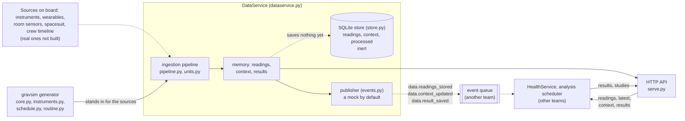

# gravsim: the DataService and the simulated data behind it

**Local demo update:** `SqliteStore` now persists readings, context and results. `gravsim.serve --db PATH --queue PATH` uses file-backed storage and publishes events to a SQLite queue while the mission clock advances. See the [root README](../README.md) for the full multi-process demo. The older descriptions of the store as inert and the queue as exclusively mocked below describe the original design; the mock remains the default without `--queue`.

**Watch:** `gs.Watch` is the crew's first line of monitoring: heart rate every 15 minutes, all day, and the night's sleep (6.9 h on the ground, 6.09 h in flight, Barger et al. 2014). The timeline reads it every day, so a 180-day mission has about 23 000 watch readings per crew member; the DataService filters by measure in SQL and in memory, and `GET /api/v1/readings` takes `start` to ask only for a window. `crew.add_fatigue(day, days)` or `--fatigue CM-3:132:6` makes a spell only the watch and the wearable see (resting heart rate +12 %, HRV −30 %, about 1.6 h less sleep). Design and the analysis built on it: [docs/wearable.md](../docs/wearable.md).

**Booked retests:** with `--run-booked`, the generator also runs each retest the Planner books (a `retest` item of its plan, a result of kind `plan`; see docs/planner.md): when its window opens, it measures the test on that measure's instrument at the start of the window and ingests it like any reading (`run_booked_studies()` in `serve.py`). It is off by default. The Planner turns a finding that is still there after a recent retest into a review, so retests no longer loop.

This folder is the health monitor's data service. The `DataService` takes in everything the sources on board produce (instrument readings and crew context: where each astronaut is and what they are doing), cleans it, keeps it, answers queries for it over Python or HTTP, and announces what it stored on the team's event queue. See `docs/architecture.md` for where it sits: Sources → DataService ↔ Database.

We have none of those sources: no dynamometer, DXA scanner, metabolic cart, flight wearable, room sensors or spacesuit. The `gravsim` generator stands in for all of them. It produces readings for a crew member on any mission day, following the curves measured in NASA's open bed-rest studies (the files in `data/nlsp/` and `sim/fit/source_data/`), and a daily routine with spacewalks for the context. Readings are random by default and fully controllable: exercise adherence over time, fast responders, injuries on a chosen day, broken instruments, spacewalks.

All data it produces is synthetic and every record says so (`synthetic: true`).

The HealthService, the queues, the analysis scheduler, the notifications and the frontend belong to other parts of the team.

A mock of the HealthService, used to feed the 3D page during the demo, lives in `sim/mocks/healthservice/` on branch `feat/sensor-simulator`.

## Quick start

You need Python 3.10 or newer. From the repository root:

```bash
cd sim
pip install -e ".[dev]"      # numpy, plus pandas and pytest
python -m pytest -q          # 115 quick checks, about 25 seconds
python -m pytest -q -m slow  # 85 stress tests against the data ranges and NASA standards, about 3 minutes
```

The stress tests sample thousands of simulated crew members; run them after changing the generator or `params.json`.

Run the DataService's API on a generated mission:

```bash
python -m gravsim.serve --day 95 --speed 20 --port 8000
curl "http://localhost:8000/api/v1/context/current?crew=CM-1"
```

Or use it from Python:

```python
import gravsim as gs

mission = gs.Mission("iss_180", launch_date="2027-03-01")
ana = mission.add_crew("CM-1", sex="F", adherence=1.0, seed=1)                        # follows the exercise routine
ben = mission.add_crew("CM-2", adherence=[(0, 1.0), (60, 0.2), (120, 1.0)], seed=2)   # skips exercise for two months
ben.add_event(day=95, measures="legs", severity_pct=12, recovery_days=20, label="ankle sprain")
ana.add_eva(day=110, start_hour=12, hours=6.5)                                        # a spacewalk on flight day 111

data = gs.DataService()
data.ingest(mission.timeline(seed=7))      # gravsim plays the instruments, on NASA's schedule
data.ingest_context(mission.context())     # and the crew timeline, room sensors and spacesuit

data.readings("CM-2", "knee_extension_60", end=mission.timestamp(120))   # 6 readings, L-60 to FD105
data.latest("CM-2", "bone", at=mission.timestamp(200))                   # newest hip, spine and heel scans (R+7)
data.current_context("CM-1", mission.timestamp(110.1))                   # eva, outside, from the suit, 12:00 to 18:30
data.save_result("CM-2", "study", mission.timestamp(120), {"study": "functional_fitness", "status": "scheduled"})
data.publisher.messages[-1]["topic"]                                     # 'data.result_saved'
```

`examples/gravsim_demo.ipynb` shows what the generator makes, with charts against the bed-rest data, and ends with crew context and events in the DataService. It also needs altair 5 (`pip install -e ".[examples]"`); run it from `sim/examples`.

## How the pieces fit



| Part | File | What is in it |
|---|---|---|
| Generator: stands in for the sources | `gravsim/core.py` | `Mission`, `CrewMember` (with `add_event()` and `add_eva()`) and the physiology curves |
| | `gravsim/instruments.py` | the five simulated instruments, the spacesuit included, and their faults |
| | `gravsim/schedule.py` | `timeline()`: who is measured on which days |
| | `gravsim/routine.py` | crew context: the daily routine, spacewalks, `context_timeline()` |
| Shared by every part | `gravsim/measures.py` | the list of measures (names, units, limits, groups) from `params.json`; the DataService depends on this list, never on the generator |
| | `gravsim/reading.py` | `Reading` (raw data), `ContextRecord` (crew context), `Result` (processed data); `to_dataframe()` |
| DataService | `gravsim/dataservice.py` | `DataService`: `ingest()`, `readings()`, `latest()`, `ingest_context()`, `context()`, `current_context()`, `save_result()`, `results()` |
| | `gravsim/pipeline.py` | `clean()` and `clean_context()`: the ingestion rules, and `LIMITS` |
| | `gravsim/units.py` | the unit registry and `convert()` |
| | `gravsim/store.py` | the SQLite schema (readings, context, processed results) and `SqliteStore`, inert |
| | `gravsim/events.py` | the event topics, their messages and `MockPublisher` |
| | `gravsim/serve.py` | the HTTP API |
| Fit | `fit/fit_params.py` | refits `gravsim/params.json` from `data/nlsp/` and `fit/source_data/` |
| | `fit/source_data/` | the MR079G strength studies other than CFT70, which the fit needs and `data/nlsp/` no longer holds (see its README) |
| Checks | `tests/` | the generator against the data and NASA's standards, the DataService, context, events |

## The DataService

It holds all the data: raw readings, crew context and the processed results other services compute from them.

- `ingest(records)` runs readings through the pipeline and keeps them. A record is a `Reading` or a plain dict with at least `crew_id`, `measure`, `timestamp`, `value` and `unit`, so any sensor can send one.
- `readings(crew_id, measures=None, start=None, end=None)` returns a crew member's readings in a time range, oldest first, whatever their quality. `measures` takes ids or group names (`"bone"`); times can be ISO text, a `datetime` or Unix seconds.
- `latest(crew_id, measures=None, at=None)` returns the newest reading of each measure that has quality `ok`.
- `ingest_context(records)`, `context(crew_id, start=None, end=None)` and `current_context(crew_id, at)` do the same for crew context (see "Crew context").
- `save_result(crew_id, kind, timestamp, payload)` keeps a processed result: what was computed for a crew member at a mission time, as a `Result` with the JSON `payload`, the time it was computed and the model version. Computing the same kind for the same crew member, time and model version again replaces it. The analysis scheduler records the studies it schedules the same way, as kind `study`.
- `results(crew_id, kind=None, start=None, end=None)` reads them back, oldest first, for one kind or all of them, in a range of mission times.
- `DataService(publisher=...)` takes the event queue; every call that stores something announces it (see "Events").

A reading from a real sensor goes in the same way as gravsim's:

```python
[r] = data.ingest([{"crew_id": "CM-1", "measure": "resting_hr", "timestamp": "2027-06-01T09:30:00+02:00",
                    "value": 1.15, "unit": "beats/s", "instrument": "chest strap"}])
r.timestamp, r.value, r.unit, r.quality      # ('2027-06-01T07:30:00Z', 69.0, 'bpm', 'ok')
```

Strength goes in the same way: gravsim's dynamometer reports ft-lb, as NASA's files do, and the DataService stores N·m.

```python
[r] = data.ingest([gs.Dynamometer(seed=3).measure(ben, day=104, measure="knee_extension_60")])
r.value, r.unit, r.truth["value"]            # (85.6, 'N·m', 73.115): 63.1 ft-lb from the dynamometer
```

**Ingestion rules** (`pipeline.py`), applied to every reading, gravsim's included:

1. A record with no crew member, no known measure or no readable time is dropped, and a warning says how many.
2. Times are stored as UTC ISO text to the second, `2027-03-01T12:00:00Z`. A time with no offset is taken as UTC.
3. A missing or unreadable value becomes `None` with quality `missing`. It is kept, because a gap is information too.
4. The value is converted to the unit its measure is stored in (`STORED_UNITS`), and so is gravsim's `truth` value. An unknown unit, or one of the wrong kind (kg for a heart rate), keeps value and unit as sent and gets quality `bad_unit`.
5. A value outside the physiological limits in `LIMITS` gets quality `out_of_range` and is kept unrounded. The limits are wide on purpose: a resting heart rate of 1.2 is beats per second sent as bpm, not a very calm astronaut. Values inside the limits are rounded to the measure's decimals. gravsim clamps its own readings to the same table, so nothing it makes is flagged. `LIMITS` is in each measure's `params.json` unit, ft-lb for strength, and the pipeline converts it before checking.
6. For readings with the same crew member, measure, time, instrument and side, the last one sent wins. The result is sorted by time.

Consumers should use readings with quality `ok`.

**Units** (`units.py`). Each measure is stored in one canonical unit, listed in `gs.STORED_UNITS`. `UNITS` maps every accepted unit to the canonical unit of its kind and a factor, and `gs.convert(100, "ft-lb", "N·m")` gives 135.58. The canonical unit is the one `params.json` gives the measure, except for strength: the fit, `params.json` and the simulated dynamometer keep ft-lb, as NASA's files do, and the DataService stores N·m (1 ft-lb = 1.35582 N·m), so the whole system and the website use one SI unit.

| Canonical unit | Also accepted |
|---|---|
| N·m (torque) | Nm, ft-lb |
| g/cm² (bone density) | g/cm2, mg/cm², mg/cm2 |
| g (lean mass) | kg, lb |
| bpm (heart rate) | beats/s |
| mmHg (blood pressure) | kPa |
| % (SpO2) | fraction (0.97 for 97 %) |
| ms (HRV) | s |
| ml/kg/min (VO2peak) | |

To accept a new unit, add one line to `UNITS`.

**The store** (`store.py`) is where real sensor data, imported historical data, crew context and the processed results would live. For the challenge it does nothing on purpose: `SqliteStore` creates its three tables (in memory by default), its save methods write nothing and its query methods return an empty list, so the demo runs on what the DataService holds in memory.

- `readings` has one row per reading, keyed by crew member, measure, time, instrument and side, with the value in its canonical unit, the quality, a `synthetic` flag and the remaining fields as JSON.
- `context` has one row per context record, keyed by crew member, source and start, with the end, activity, location and a `synthetic` flag. The column `"end"` is quoted in SQL because END is a keyword.
- `processed` has one row per result: crew member, kind, the mission time it is for, when it was computed, the model version and the payload as JSON. The key is crew member, kind, time and model version, so a recomputed result replaces the old one and a new model version adds a row that can be compared with the old.

Making it real means an `INSERT OR REPLACE` in `save()`, `save_context()` and `save_results()` and a `SELECT` in `query()`, `query_context()` and `query_results()`.

**The API** (`python -m gravsim.serve`, standard library only, port 8000 by default). At start-up it generates a random mission, readings and context, and ingests it all. Requests see the data up to the mission clock ("now").

| Method and path | Returns |
|---|---|
| `GET /api/v1/mission` | the mission: `name`, `launch_date`, `phases` (each with `start`, `end` and `gravity_g`), the clock (`now_day`, `now`) and the `crew` with each member's `sex`. Other services read the mission and its clock here instead of importing gravsim |
| `GET /api/v1/readings` | every reading so far, as JSON records |
| `GET /api/v1/latest` | the newest usable reading of each measure |
| `GET /api/v1/context` | context records under way between `start` and `end` (default: the 24 hours up to now) |
| `GET /api/v1/context/current` | the context record under way at `at` (default: now), or `null` |
| `GET /api/v1/results` | processed results of one `kind` or all, including ones dated later than the mission clock (a study booked ahead); `start` and `end` narrow it |
| `POST /api/v1/results` | saves a result sent as JSON (`crew_id`, `kind`, `timestamp`, `payload`, optional `model_version`) and returns it, status 201 |

Query parameters, all optional: `crew=CM-2` (default: the first), `day=150` (the mission day used as now; default: the mission clock), `measures=bone,vo2peak` (`/readings` and `/latest`), `start` and `end` (ISO times), `at` (an ISO time), `kind=study`, `truth=1` (`/readings` and `/latest` only: also send each reading's `truth` and `status`, the simulator's hidden state, which a real monitor would never see; leave it off unless you are scoring a detector). A bad parameter answers 400 and an unknown crew member 404, with the error as JSON. `--speed 20` moves the mission clock 20 days per real minute, so a client that polls sees the mission unfold.

## Crew context

The HealthService decides who is told about an alert using crew context: if an astronaut is on a spacewalk or in the bathroom, another crew member is told. The DataService holds that context as `ContextRecord`s:

| Field | What it holds |
|---|---|
| `crew_id` | who |
| `start`, `end` | UTC ISO times; the record covers `start` up to, not including, `end`, where the next one starts |
| `activity` | `sleep`, `exercise`, `work`, `meal`, `hygiene` or `eva` (a spacewalk) |
| `location` | an ISS module (`Harmony`, `Tranquility`, `Unity`, `Destiny`, `Columbus`, `Kibo`, `Quest`), `outside` on a spacewalk, or `None` |
| `source` | who reported it: `timeline` (the crew timeline, the plan), `room_sensor` (presence sensors in the modules) or `suit` (spacesuit telemetry); any text from a real source |
| `synthetic` | `true` for everything gravsim makes |

**In the DataService.** `ingest_context(records)` takes `ContextRecord`s or plain dicts with the same keys and applies the same rules as readings where they fit (`clean_context()` in `pipeline.py`): a record without a crew member, a known activity, or a readable start before its end is dropped with a warning; times become UTC ISO text; of several records with the same crew member, source and start, the last one sent wins. `context(crew_id, start, end)` returns the records under way at any time from `start` to `end`, both included, oldest first. `current_context(crew_id, at)` returns the one record under way at `at`, or `None` (before launch, for instance). When sources overlap, observed beats planned: the suit, then a room sensor, then the timeline; within one source the newest record wins.

```python
data.ingest_context([{"crew_id": "CM-1", "start": "2027-06-19T10:40:00+02:00", "end": "2027-06-19T08:52:00Z",
                      "activity": "hygiene", "location": "Tranquility", "source": "room_sensor"}])
data.current_context("CM-1", "2027-06-19T08:45:00Z").activity     # 'hygiene': the room sensor beats the plan
```

**The routine gravsim generates** (`routine.py`). Every crew member follows the same plan each day, in UTC, the time the ISS keeps. The hours are assumed, in the shape of an ISS day:

| UTC | Activity | Location | Source |
|---|---|---|---|
| 00:00 to 06:00 | sleep | Harmony (crew quarters) | timeline |
| 06:00 to 06:30 | hygiene | Tranquility (toilet and hygiene compartment) | timeline |
| 06:30 to 07:00 | meal | Unity (galley) | timeline |
| 07:00 to 09:00 | work | a module drawn for the block: Destiny, Columbus, Kibo or Harmony | timeline |
| 09:00 to 10:00 | exercise, or work if skipped | Tranquility (resistance machine, treadmill) | timeline |
| 10:00 to 12:00 | work | drawn | timeline |
| 12:00 to 13:00 | meal | Unity | timeline |
| 13:00 to 16:00 | work | drawn | timeline |
| 16:00 to 17:00 | exercise, or work if skipped | Destiny (cycle ergometer) | timeline |
| 17:00 to 19:00 | work | drawn | timeline |
| 19:00 to 20:00 | meal | Unity | timeline |
| 20:00 to 22:00 | work (off-duty time included) | drawn | timeline |
| 22:00 to 22:30 | hygiene | Tranquility | timeline |
| 22:30 to 24:00 | sleep, until 06:00 the next day | Harmony | timeline |

Each exercise block happens with probability equal to the person's exercise adherence that day, so `adherence=0` never exercises and `adherence=[(0, 1.0), (60, 0.2), ...]` mostly stops on day 60. One to three unplanned toilet visits of 5 to 15 minutes, reported by the room sensor, replace that stretch of a work block, so the timeline's own records have short gaps there and the two sources together cover the day.

**Spacewalks.** `crew.add_eva(day, start_hour=12, hours=6.5)` sends a crew member outside on the UTC date of mission `day`. That day's routine gets an hour in the Quest airlock to suit up, the spacewalk itself (`eva`, `outside`, source `suit`), an hour in the airlock after, and no exercise. It must be on a day away from Earth, start at 08:00 or later and end by 21:00, one per date. `gs.Mission.random()` sends two crew members out together, for 5.5 to 7.5 hours on one flight day, in about half the missions.

During the spacewalk the spacesuit (`gs.Spacesuit`, instrument `suit`) reports heart rate every 5 minutes as `Reading`s of the measure `heart_rate`, which `mission.timeline()` includes. It is a measure of its own, not `resting_hr`, so `latest("resting_hr")` never returns a spacewalk value. Its level is the person's resting heart rate that day plus an effort that changes with each 20-to-40-minute task, between 0.2 and 0.5 of the way to maximum heart rate (assumed; there is no spacewalk data behind it).

**Agreement with the wearable.** The wearable's 24-hour trace (`Wearable.session()`, minute 0 is 00:00 UTC) follows the same routine and returns it as `"context"`: it dips while the person sleeps, rises in the exercise blocks that happened and nowhere else, and on a spacewalk shows the same heart rate the suit reports. A day's routine depends only on the crew member and the date, through its own random stream, so it comes out the same however often it is asked for, adding a spacewalk changes no other day, and the same seeds give the same context.

**The context timeline.** `mission.context(crew=None, start=0, until=None)` gives every crew member's records from launch to landing by default, the time on board where these sources exist. A night's sleep is one record, 22:30 to 06:00. `crew.routine(day)` gives one UTC date, 00:00 to 24:00.

## Events

The team's event queue is publish/subscribe for things that happened: the HealthService recomputes when new data arrives, and the analysis scheduler reacts to results and recorded studies. The DataService announces what it stores through a publisher, any object with `publish(topic, message)`:

```python
class Queue:                                  # whatever the queue team builds
    def publish(self, topic: str, message: dict) -> None:
        ...

data = gs.DataService(publisher=Queue())
```

The default, `gs.MockPublisher`, stands in for the queue: it logs each message (logger `gravsim.events`, level INFO) and keeps the latest 10,000 in `data.publisher.messages` as `{"topic": ..., "message": ...}`.

Messages say what changed, not the data itself; a subscriber asks the DataService for that. All of them are JSON-serialisable, with UTC ISO times and sorted lists. A call that stores nothing publishes nothing.

| Topic | When | Message |
|---|---|---|
| `data.readings_stored` | once per crew member per `ingest()` call | `crew_id`, `count`, `measures` (sorted ids), `start` and `end` (earliest and latest reading time) |
| `data.context_updated` | once per crew member per `ingest_context()` call | `crew_id`, `count`, `activities` (sorted), `start` (earliest start) and `end` (latest end) |
| `data.result_saved` | every `save_result()`, a replaced result included | `crew_id`, `kind`, `timestamp` (the mission time it is for), `computed_at`, `model_version` |

```json
{"topic": "data.readings_stored", "message": {"crew_id": "CM-1", "count": 5, "measures": ["hrv_rmssd", "resting_dbp", "resting_hr", "resting_sbp", "spo2"], "start": "2027-06-19T12:00:00Z", "end": "2027-06-19T12:00:00Z"}}
{"topic": "data.context_updated", "message": {"crew_id": "CM-1", "count": 1, "activities": ["hygiene"], "start": "2027-06-19T08:40:00Z", "end": "2027-06-19T08:52:00Z"}}
{"topic": "data.result_saved", "message": {"crew_id": "CM-2", "kind": "study", "timestamp": "2027-06-29T12:00:00Z", "computed_at": "2026-11-15T10:00:00Z", "model_version": "0.2.0"}}
```

The Planner keeps each crew member's plan with `save_result(crew_id, "plan", <mission start>, {"items": [...]}, model_version="planner-1")` and reads it back with `results(crew_id, kind="plan")`; the item contract is in docs/planner.md.

## The generator

**Mission.** A list of phases with a gravity level. Presets:

| Preset | Phases | Covered by the data? |
|---|---|---|
| `iss_180` (default) | 180 days at 0 g, then a year back on Earth | Up to day 90; after that the curves are extrapolated |
| `artemis_30` | 12 days transit, 6 on the Moon (0.166 g), 12 back | Assumption: no data for partial gravity |
| `mars` | 180 days transit, 500 on Mars (0.38 g), 180 back | Assumption: no data for partial gravity or for 860 days |

Custom missions: `gs.Mission([gs.Phase("flight", 0, 120, 0.0), ...])`. Partial gravity scales the unloading by `1 - g` unless you pass `unloading=` your own function. `mission.timestamp(day)` and `mission.day_of(timestamp)` convert between mission days and UTC times.

**CrewMember.** One person, consistent across readings. Sex, age and mass (random if not given), a baseline for every measure and a personal response (sampled from the spread between subjects, at most 2 SD from the median). Baselines come from the subjects' own pre-bed-rest values for that sex, never below the smallest or above the largest of them. They are drawn together: of two people of the same sex, the one with more leg muscle is usually the stronger and the heavier (a Gaussian copula fitted on the 65 subjects with both strength and DXA data), and systolic and diastolic pressure move together. The status controls:

| Status | Parameter |
|---|---|
| Normal (following the routine) | `adherence=1.0`, the Campaign 11 exercise group's curve |
| Not normal (no exercise) | `adherence=0.0`, the control groups' curve |
| Partly following it | `adherence=0.6`, or steps over time: `[(0, 1.0), (60, 0.2), (120, 1.0)]`, or a function of the day |
| Damaged: losing faster than almost everyone | `responder="fast"` (between the 90th percentile and 2 SD), or a number of standard deviations (cut to -2..2) |
| Damaged: an event | `crew.add_event(day, measures="legs", severity_pct=12, recovery_days=20)` |
| Broken instrument | `Fault("offset", start, end, pct=-1.1)`, `"drift"`, `"dropout"`, `"spike"`, `"stuck"` on the instrument; after a dropout, later faults have nothing to act on |
| Outside on a spacewalk | `crew.add_eva(day, start_hour=12, hours=6.5)` (see "Crew context") |

Measure groups for events and queries: `legs`, `trunk`, `arms`, `bone`, `cardio`, `strength`.

**Instruments.** `measure(crew, day, measure)` returns one `Reading`, `measure_all(crew, day)` one per measure, and `session(crew, day)` the whole session as the device records it.

```python
r = gs.Dynamometer(seed=3).measure(ben, day=104, measure="knee_extension_60")
r.value, r.unit, r.day_label      # (63.1, 'ft-lb', 'FD105'): one test, noise included; 85.6 N·m once ingested
r.truth                           # {'value': 53.927, 'change_pct': -27.917, 'faults': []}
```

| Instrument | Measures | `session()` |
|---|---|---|
| `Dynamometer` | knee extension/flexion 60°/s, ankle plantar/dorsiflexion 30°/s, trunk extension/flexion 60°/s (reported in ft-lb, stored in N·m) | every test with its repetitions |
| `DxaScanner` | hip, spine, heel bone density (g/cm²); lean mass of legs, arms, trunk (g) | full report, left and right hip |
| `CycleErgometer` | VO2peak (ml/kg/min) | graded test stage by stage: watts, heart rate, VO2, Borg, ending part-way through the last stage at the workload where the person reaches VO2peak |
| `Wearable` | resting heart rate, systolic and diastolic pressure, SpO2, HRV | 24 hours of minute-by-minute heart rate, following the day's routine |
| `Spacesuit` | heart rate during a spacewalk (bpm), every 5 minutes | (none; `measure_all()` returns the whole spacewalk) |
| `Watch` | heart rate every 15 minutes (`watch_hr`, bpm), the night's sleep (`sleep_hours`, h; `sleep_quality`, 1–7) at 06:00 UTC | (none; `measure_all()` returns the whole day) |

`noise=0` on an instrument (or on `timeline()`) turns measurement noise off; `noise=0.5` halves it. Noise has two parts: the instrument's own (assumed from typical device accuracy) and the person's day-to-day variation (the rest of what repeat tests in the data show), which every reading of that measure on that day shares. Inside the data's coverage a reading without a fault is clipped to the data range (see "What the data checks guarantee"); faults may push it out. Every reading, faulty or not, stays inside the hard limits in `LIMITS`.

**Reading fields.** `crew_id`, `mission_day`, `day_label` (L-30, FD12, R+5), `timestamp`, `phase`, `gravity_g`, `instrument`, `device`, `measure`, `label`, `value`, `unit`, `region`, `muscle_keys` (the 3D page's keys, e.g. `quadriceps_l`), `side`, `quality` (`ok`, `missing`, `out_of_range` or `bad_unit`), `synthetic`, `extrapolated`, `model_version`, `status` (adherence, responder, recent events) and `truth` (noise-free value, true % change, active faults). A real monitoring system would not see `truth`; it is there to score one. Real sensors leave the mission fields and `truth` empty. `gs.to_dataframe(readings)` makes a pandas DataFrame with one row per reading.

**Timeline.** `mission.timeline()` uses the NASA routine from `docs/investigacion-gravedad.md` and OCHMO-STD-100.1A Table 8 (rows cited in `schedule.py`): DXA only before and after flight (there is no DXA on the ISS), strength every 30 days, VO2peak on flight days 14, 75 and 165 and 14 days before return, the wearable daily, two baseline sessions before launch, and the spacesuit during spacewalks. `mission.timeline(schedule=7)` reads everything every 7 days instead (the suit still reads only during spacewalks). `until=day` gives the timeline so far. `gs.Mission.random(seed=...)` makes a crew with random statuses (some slipping on exercise, the odd fast responder or injury, a spacewalk in about half the missions).

## How the curves are built

The data measured people before and after 21 to 90 days of head-down bed rest, with few readings in between. So the shape over time comes from comparing studies of different lengths, and from the follow-up scans after them.

- Strength, lean mass, VO2peak, resting heart rate and pressure approach a plateau with a time constant of 28.5 days, fitted on knee extension across HDT30 (30 days), Campaign 1 (60), Campaign 3 (60 or 90) and Campaign 11 (70). Back in gravity they recover with their own time constant.
- Bone density falls at a steady rate per unloaded day and recovers slowly afterwards (Campaign 3 follow-up scans up to two years).
- Exercise scales the loss by `1 - exercise_effect × adherence`, with the effect taken from Campaign 11's exercise and control groups and capped at 0.9. The spread between people shrinks with exercise, but to no less than half.
- Each measure has a direction: strength, lean mass, bone and VO2peak fall, resting heart rate and pressure rise. A person's loss never crosses zero into improvement while unloaded.
- The spread between people comes from the post-bed-rest changes of each cohort, after dropping failed tests (such as a -73 % knee extension in MEDES) and subtracting measurement noise.
- Measurement noise comes from repeat tests before bed rest and from same-day duplicate DXA scans. For DXA all of it is the scanner. For the other instruments an assumed device noise is taken out and the rest is the person's day-to-day variation.
- Baselines: the pre-bed-rest values of every subject in the files (137 people for strength: AG Pilot, Campaign 1, 3 and 17, CFT70, HDT30 and MEDES), kept as quantiles per sex in `params.json`.

`params.json` holds every number with its source; `python fit/fit_params.py` refits it from `data/nlsp/` and `fit/source_data/`, and `python fit/fit_params.py --table` prints this table from it. `data/nlsp/` keeps only CFT70 of the strength studies, the one the website uses, and CFT70 has a single length of bed rest, so the fit reads the other strength studies from `fit/source_data/`. `params.json` keeps strength in ft-lb, as in the files; the table shows it in N·m, as the DataService stores it. The current fit ("pts" are percentage points of change; noise as a share of the value):

| Measure | Instrument | Unit | Worse is | Shape without exercise | Loss prevented by full exercise | Spread between people | Recovery time constant | Noise: device + day to day | Baselines drawn from | Assumed instead of fitted |
|---|---|---|---|---|---|---|---|---|---|---|
| `knee_extension_60` | dynamometer | N·m | lower | plateau -23.5% | 64% | 5.7 pts | 19 d | 5.0% + 6.7% | 67.1 to 445.3 (137 people) | none |
| `knee_flexion_60` | dynamometer | N·m | lower | plateau -13.6% | 90% | 5.8 pts | 19 d | 5.0% + 8.9% | 42.7 to 241.6 (137 people) | exercise effect capped at 0.9 (fitted 1) |
| `ankle_plantarflexion_30` | dynamometer | N·m | lower | plateau -25.7% | 12% | 3.8 pts | 19 d | 5.0% + 9.2% | 57.2 to 252.6 (137 people) | none |
| `ankle_dorsiflexion_30` | dynamometer | N·m | lower | plateau -6.8% | 70% | 3.3 pts | 19 d | 5.0% + 8.9% | 14.2 to 66.4 (137 people) | exercise effect |
| `trunk_extension_60` | dynamometer | N·m | lower | plateau -17.7% | 77% | 9.3 pts | 19 d | 5.0% + 7.2% | 98.6 to 852.1 (128 people) | none |
| `trunk_flexion_60` | dynamometer | N·m | lower | plateau -2.8% | 70% | 8.1 pts | 19 d | 5.0% + 11.2% | 67.4 to 387.8 (128 people) | exercise effect; Campaign 11 left out (runs the wrong way) |
| `hip_bmd` | DXA | g/cm² | lower | -1.38% per month | 50% | 0.46 pts/month | 405.5 d | 0.8% + 0.0% | 0.822 to 1.270 (74 people) | exercise effect |
| `spine_bmd` | DXA | g/cm² | lower | -0.10% per month | 50% | 0.71 pts/month | 399 d | 0.6% + 0.0% | 0.880 to 1.193 (74 people) | exercise effect; spaceflight loss likely larger |
| `heel_bmd` | DXA | g/cm² | lower | -0.38% per month | 50% | 0.88 pts/month | 286.2 d | 0.8% + 0.0% | 0.474 to 0.861 (50 people) | exercise effect |
| `lean_legs` | DXA | g | lower | plateau -6.5% | 64% | 4.7 pts | 19 d | 0.9% + 0.0% | 9515 to 26748 (74 people) | loss time constant; exercise effect; recovery time constant |
| `lean_arms` | DXA | g | lower | plateau +0.0% | 64% | 0.0 pts | 19 d | 2.1% + 0.0% | 2973 to 11118 (74 people) | loss time constant; exercise effect; recovery time constant; loss set to 0 (fitted +0.2%) |
| `lean_trunk` | DXA | g | lower | plateau -1.0% | 64% | 3.2 pts | 19 d | 0.9% + 0.0% | 16460 to 36053 (74 people) | loss time constant; exercise effect; recovery time constant |
| `vo2peak` | cycle | ml/kg/min | lower | plateau -22.2% | 70% | 8.6 pts | 16.8 d | 3.0% + 4.8% | 33.0 to 53.6 (42 people) | loss time constant |
| `resting_hr` | wearable | bpm | higher | plateau +31.1% | 54% | 8.5 pts | 6.2 d | 3.0% + 4.9% | 54 to 100 (38 people) | loss time constant |
| `resting_sbp` | wearable | mmHg | higher | plateau +3.3% | 0% | 1.9 pts | 10 d | 3.3% + 4.9% | 102 to 138 (38 people) | loss time constant; recovery time constant |
| `resting_dbp` | wearable | mmHg | higher | plateau +13.4% | 1% | 3.5 pts | 10 d | 4.0% + 6.8% | 64 to 86 (38 people) | loss time constant; recovery time constant |
| `spo2` | wearable | % | lower | constant |  |  |  | 1.0% + 0.0% | 95 to 100 (assumed) | everything (no data) |
| `hrv_rmssd` | wearable | ms | lower | constant |  |  |  | 5.0% + 14.1% | 15 to 90 (assumed) | everything (no data) |
| `heart_rate` | spacesuit | bpm | higher | resting heart rate + effort |  |  |  | 3.0% + 0.0% | none of its own | everything (no data) |

`tests/test_gravsim.py` checks the curves against the data: knee extension at 30 and 70 days with and without exercise, VO2peak at 70 days, hip loss per month, VO2 recovery, the spread between subjects, and the heart-rate rise at the same cycling workload (Campaign 3: a median 27.5 bpm).

## What the data checks guarantee

Two test files check the generator against numbers it was not fitted with. `tests/data_ranges.json` holds the smallest and largest value of every measure in the raw NASA files, in the files' units (ft-lb for strength), so the tests check the generator's own output. It was derived by a separate verification script that is not in the repository: the script read the raw files directly (the strength studies now in `data/nlsp/` and `fit/source_data/`), without going through the fit. To change a range, edit the JSON by hand and say in the commit where the number comes from. `tests/nasa_standards.json` holds NASA's thresholds, each with its document, page and quote. When `python -m pytest -m slow` passes, this holds:

- Every crew member starts with values a real bed-rest subject had. Nobody is stronger, weaker or fitter, or has denser or thinner bones, than the extremes in the data.
- A reading taken before launch with a working instrument is never outside the smallest and largest pre-bed-rest value in the data. Up to 90 days without gravity it is never outside what the subjects showed after bed rest: their starting range combined with their range of change.
- A person's true change up to 90 days without gravity stays inside the range of changes the subjects showed.
- No reading is physically impossible, even from a broken instrument: oxygen saturation at most 100 %, heart rate 30 to 220, systolic pressure 60 to 250, diastolic 30 to 150, nothing negative. The DataService checks the same limits.
- A reading outside the data's range always says why: it is flagged `extrapolated` (more than 90 days without gravity, or partial gravity), or the fault that moved it is listed in `truth["faults"]`.
- Measures move the way the body does. Without gravity, strength, lean mass, bone and aerobic capacity go down or stay, and resting heart rate and pressure go up or stay. Skipping exercise never leaves a person better off than exercising, an injury never helps, and a fast responder never gains.
- The same seeds give the same data, a person's two hips differ by at most 3 %, and leg strength goes with leg muscle.
- Crew start out meeting NASA's entry numbers: VO2peak of at least 32.9 ml/kg/min and resting pressure below 140/90.
- On the exercise routine, at least 9 in 10 crew keep VO2peak and knee and trunk strength above 80 % of their pre-flight value, as NASA requires in flight. Without exercise, the typical crew member falls below it between 3 weeks and 3 months. Hip loss, recovery within 45 days for VO2 and strength, and about a year for bone match the NASA documents.

What they do not guarantee: anything past 90 days without gravity, or in partial gravity, is the fitted curve continued. Two known gaps are kept on purpose and marked as expected failures (see "Decisions").

## Decisions (open to veto)

These are choices, not facts from the data. Each one can be undone in one place, named in brackets.

1. Crew are astronauts, so baselines come only from bed-rest subjects who meet NASA's standards: VO2peak of at least 32.9 ml/kg/min (NASA-STD-3001 Vol 1 Rev C [V1 4001]) and resting pressure below 140/90 mmHg (OCHMO-STD-100.1A Rev A, Appendix A, G.3). That keeps 42 of 68 subjects for VO2peak and all 38 for pressure. [`ASTRONAUT` in `fit/fit_params.py`]
2. Calf strength on the exercise routine breaks NASA's 80 % rule [V1 4024]: about 3 in 4 crew lose more than 20 % by flight day 180. Bed-rest exercise barely protected the calves (Campaign 11's exercise group lost 19 %, the controls 21 %), while ISS exercise targets them. gravsim follows the data and invents no protective effect. The test is an expected failure. [`test_standards.py`]
3. About 1 in 10 single pre-flight pressure readings reach 140/90, though no crew member's true pressure and no 14-day average does. The day-to-day variation comes from the only repeat pressures in the data, two clinic visits weeks apart in CFT70 (14 people). Expected failure. [`test_standards.py`]
4. Spine density barely changes in bed rest (-0.1 % a month). gravsim keeps it at zero or falling; in spaceflight the spine likely loses more than bed rest suggests.
5. Arm lean mass was fitted at +0.2 %, so its loss is set to 0 and readings vary only by scanner noise. [`finish()` in `fit/fit_params.py`]
6. Exercise removes at most 90 % of a loss (knee flexion was fitted at 100 %, which made every exercising person identical), and responses are cut at 2 SD from the median. [`MODEL` in `fit/fit_params.py`]
7. Device noise per reading is assumed: dynamometer ±5 %, gas analyser ±3 %, pressure cuff ±3 to 4 mmHg, heart rate ±2 bpm. [`DEVICE` in `fit/fit_params.py`]
8. Each strength subject is counted once: Campaign 11's strength file repeats CFT70's tests for 15 of its people, so the files hold 137 people, not 152. Sex comes from the DXA files and the CFT70 demographics, which share subject codes with the strength files; HDT30 and Campaign 17 have no sex in the files and only enter the pooled distribution.
9. Hip density is the average of both hips per scan, matching the left and right readings `DxaScanner.session()` reports around it.
10. The daily routine is one fixed plan in UTC, in the shape of an ISS day (the table in "Crew context"); its hours, modules and toilet visits are assumed. Each exercise block happens on its own, with probability equal to that day's adherence. `work` also covers off-duty time, to keep to six activities. [`DAY_PLAN` in `routine.py`]
11. A spacewalk gets an hour in the airlock before and after and no exercise that day; it starts at 08:00 or later and ends by 21:00. Its effort is 0.2 to 0.5 of the way from resting to maximum heart rate, changing every 20 to 40 minutes. [`AIRLOCK_HOURS` in `routine.py`, `EVA_EARLIEST_START` in `core.py`, `EVA_EFFORT` in `instruments.py`]
12. The suit's heart rate is a measure of its own, `heart_rate`, rather than `resting_hr` sent by the suit, so a resting value is never a spacewalk value. It is "derived": computed from the resting heart rate, with no baseline of its own, and it draws nothing per person, so the same seeds still give the same crews and readings as before. This entry is the only change to `params.json`. [`ASSUMED_SUIT` in `fit/fit_params.py`]
13. Context covers launch to landing by default, the time on board; on the ground `current_context()` returns `None`. [`context_timeline()` in `routine.py`]
14. When context records overlap, observed beats planned (suit, then room sensor, then timeline), then the newest record wins. A record is identified by crew member, source and start. [`current_context()` in `dataservice.py`, `context_key()` in `pipeline.py`]
15. `Mission.random` draws its spacewalk after the crew, so a seed gives the same people it gave before spacewalks existed. [`Mission.random` in `core.py`]
16. Events say what changed, not the data: one message per crew member per call and one per saved result, a replaced result announced again, nothing when nothing was stored. The DataService stores first and publishes after. If `publish()` raises, the data is kept, the remaining messages of that call are still sent, and the first error reaches the caller. [`events.py`, `dataservice.py`]
17. A study the scheduler records is a result of kind `study`, not a table of its own. [`save_result()` in `dataservice.py`]
18. The DataService's API listens on port 8000, on every network interface, with `Access-Control-Allow-Origin: *` and no login, which suits a demo on a team network, not a real deployment. `POST /api/v1/results` lets services in other processes save results and studies; sensors cannot post readings or context over HTTP yet. [`serve.py`]
19. Strength is stored in N·m, the SI unit the website uses. The simulated dynamometer reports ft-lb, as NASA's files do and as a real device might, and the pipeline converts it on the way in. The fit and `params.json` stay in ft-lb, the unit of the files they read. [`STORED_UNITS` in `pipeline.py`, `UNITS` in `units.py`]
20. The fit reads CFT70 from `data/nlsp/` and the other strength studies from `fit/source_data/`, a copy of the 256 files it needs (0.4 MB), so `data/nlsp/` stays as the website needs it. [`files()` in `fit/fit_params.py`]

## Limits

- Bed rest is the ground analog NASA uses, not spaceflight. Say so wherever these numbers appear.
- Past 90 unloaded days, and in partial gravity, readings carry `extrapolated: true`. The 180-day plateau is the fitted curve continued, not a measurement.
- The exercise effect on bone has no open data (Campaign 11's DXA files are restricted); 0.5 is a placeholder.
- Spine density barely moves in the bed-rest data; spaceflight spine loss is likely larger.
- Resting heart rate and pressure come from supine rest on the day subjects got up, which includes the effect of standing up again; in flight the change may be smaller.
- The cycle test's stage values use two textbook formulas (ACSM cycling equation for VO2, Tanaka 2001 for maximum heart rate), not the data.
- SpO2 and HRV have no data behind them; their ranges and noise are assumed.
- The daily routine, the spacewalk effort and the suit's heart rate have no data behind them either.
- Women are few in the VO2peak and pressure data (1 of 38 in CFT70), so women's values there are drawn from everyone's.
- Groups were small (3 to 29 people per study) and some studies mix groups (AG Pilot, MEDES), so the spread between people is approximate.

## AI use

The code, the fitted parameters and this README were written with the help of an AI assistant (Claude), from the team's data and documents. Space Apps requires saying so in the project description.

## Data credit

NASA Life Sciences Data Archive, via the NASA Life Sciences Portal (https://nlsp.nasa.gov): MR079G Isokinetic Muscle Function (doi:10.83263/bk5h-r757), MR035G Bone Densitometry Assessment (doi:10.83263/7myc-5j86), MR080G Aerobic Capacity (doi:10.83263/w056-8t76).
